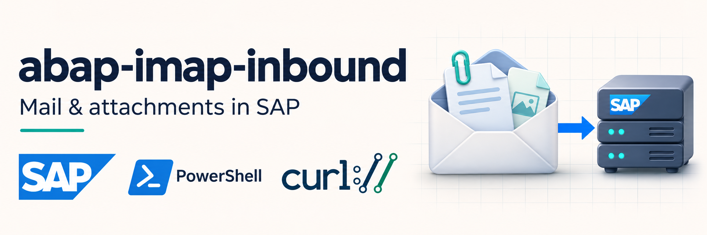
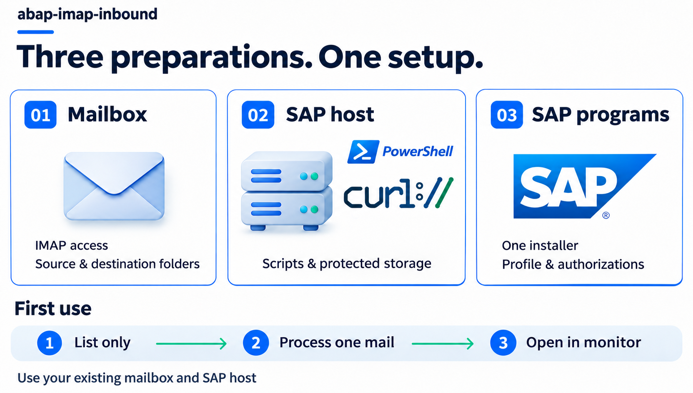
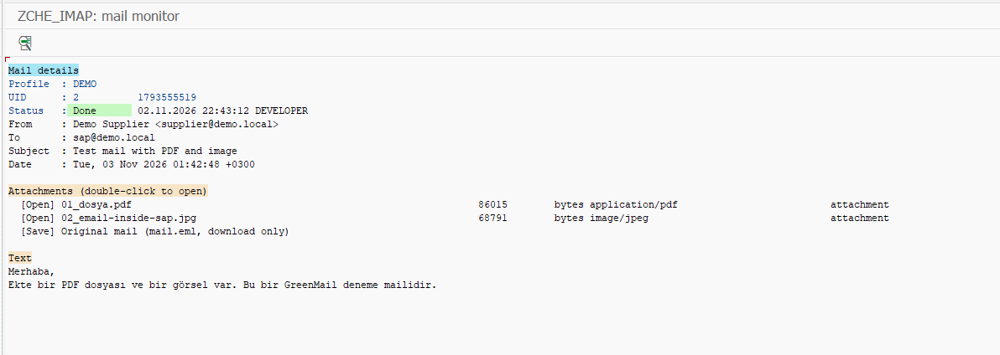

# Read emails and attachments in SAP

> **English** | [Türkçe](README.tr.md)

**Set up the SAP objects with one installer, then manage emails and attachments from SAP.**

Use this project to read messages from a mail server in SAP, retrieve attachments, and connect them to your own ABAP process. The supplied example lets you open the message and attachments in SAP. Add your own ABAP business action, such as linking an attachment to a document.

**Microsoft 365 / Exchange Online is unsupported.** This project uses IMAP with a password or app password. For Microsoft 365 mail through Microsoft Graph, see [abap-graph](https://github.com/Cheditte/abap-graph).

## Three parts to prepare

1. **Mailbox:** prepare the account SAP will read, its sign-in method, and the mail folders.
2. **Machine running SAP:** prepare PowerShell, curl, the project files, and a protected working folder. Your SAP GUI computer may be a different machine.
3. **SAP ERP:** create and execute `ZCHE_IMAP_INSTALL` in SE38, then prepare authorizations and mailbox settings.

You do not need three new servers. You can use an existing mail service and SAP host. **One installer file creates the SAP objects**; mailbox and host preparation are separate steps. No PI/PO or separate integration server is required.

We assume you can create and activate programs in SE38. Prepare the host and mailbox yourself if you administer them; otherwise the guide explains what to request from their administrators. [Start step by step](docs/WALKTHROUGH.md#prepare).

## What would you like to do?

| Your goal | Start here |
|---|---|
| Install for the first time | [Three preparations and SAP setup](docs/WALKTHROUGH.md#prepare) |
| Check connectivity and the message list | [Path A — List only](docs/WALKTHROUGH.md#list-only) |
| Open the first email and attachment in SAP | [Path B — First email](docs/WALKTHROUGH.md#first-mail) |
| Process attachments with my own ABAP code | [Developer guide](docs/TECHNICAL-GUIDE.md) |
| Run automatically at agreed intervals | [Path C — Variant and job](docs/WALKTHROUGH.md#daily-use) |
| Understand a field on the screen | [Field guide](docs/SCREEN-GUIDE.md) |

## Is your mailbox suitable?

The account must allow IMAP over TLS and password or app-password sign-in. Processing requires `UID MOVE` to move successful messages. [Mailbox requirements](docs/TECHNICAL-REFERENCE.md#before-you-start-is-your-mailbox-suitable).

The default source is **the inbox (`INBOX`)**; you can select another folder. Successful messages move to a different folder in the same account. **`SAP-Processed` is an example name, not a required new folder.** The destination you select must exist in the mailbox.

## What happens on the first run?

1. **Check connectivity:** use List only to see eligible message identifiers. This does not download content or attachments.
2. **Process one test message:** retrieve it and its attachment with the supplied example. Successful mail moves to your chosen destination.
3. **Open the result in SAP:** inspect the body and attachment in `ZCHE_IMAP_MONITOR`.

[Follow the illustrated steps from SE38 installation to SM36 job definition](docs/WALKTHROUGH.md#install).

In the A4H demonstration, this message was processed, its body displayed and its JPG opened. [See the steps and screenshots](docs/WALKTHROUGH.md#first-mail). The captures show the corrected source before its version label was raised to 0.9.3; [source and test context](docs/screenshots/README.md).

Normal processing may mark mail as read and move it. Start with **a test SAP system and a dedicated test mailbox**.

## Status and details

**Current version: [v0.9.3](https://github.com/Cheditte/abap-imap-inbound/releases/tag/v0.9.3).** Installed and run end to end on SAP ABAP Platform 2025 (SAP_BASIS 816, Linux, Unicode) with a GreenMail test mailbox: profile, connection test, list only, processing, move and attachments in the monitor. ECC 6.0, Windows hosts and production mail servers are not yet tested; feedback is welcome. [Validation record](VALIDATION.md).

- [Setup and usage](docs/WALKTHROUGH.md) · [Field guide](docs/SCREEN-GUIDE.md)
- [Preparing the host yourself](docs/SELF-MANAGED-SETUP.md)
- [Technical reference](docs/TECHNICAL-REFERENCE.md) · [Authorization and credentials](SECURITY.md)
- [Updating an existing installation](docs/WALKTHROUGH.md#upgrade) · [Optional abapGit](ABAPGIT.md)

[MIT license](LICENSE) · [Changes](CHANGELOG.md) · [Contributing](CONTRIBUTING.md) · [Report an issue](https://github.com/Cheditte/abap-imap-inbound/issues)
