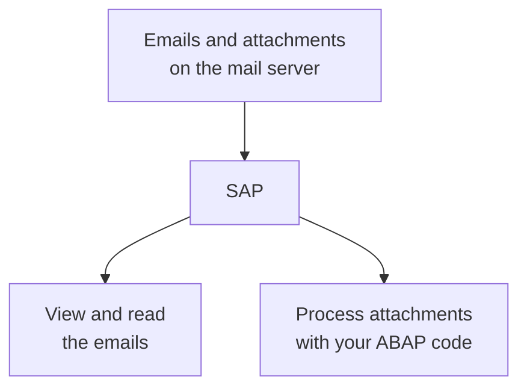
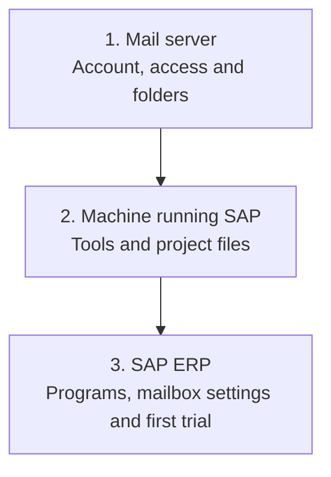

# abap-imap-inbound

> **English** | [Türkçe](README.tr.md)

Use this project to **view and read emails from a mail server in SAP, retrieve their attachments and process them**. Define the business action for those attachments in your own ABAP code.

Installation assumes **you can create, activate and run programs in SE38**. Start with a test SAP system and a dedicated test mailbox.

## The big picture: three parts to prepare

**Completing this project's installation requires preparation in three areas:**

1. **Mail server:** Prepare the account SAP will read and its connection permissions.
2. **Machine running SAP:** Prepare the helper tools and project files that retrieve mail.
3. **SAP ERP:** Install the ABAP programs, enter mailbox settings and run processing from SAP.

These are not three separate machines you need to install. The second area is the Windows/Linux side of the SAP server; the third is the work you do through SAP screens on that system. The mail service may be one you already use.

### Installation map

This map shows the preparation order. Each part is explained below.

## 1. What do you prepare on the mail server?

Choose the email account SAP will connect to and the folder it will read. Even for your own account, **a correct email address and password may not be enough**. It must allow IMAP access, so another program can read its messages, and support the sign-in method implemented by this project.

The source defaults to the **inbox (`INBOX`)**. You can select another folder. For successful messages, select a different destination in the same account. `SAP-Processed` is an initial example name; you do not have to create a new folder with that name.

**This part is ready when:** You have the actual IMAP hostname, port, security type, login details and both folder names. Check these yourself if you administer the account; otherwise obtain them from the email administrator or provider support.

[Mail account preparation steps →](docs/WALKTHROUGH.md#1-prepare-the-mail-server)

## 2. What do you prepare on the machine running SAP?

The project uses **PowerShell** and **curl** to retrieve mail. PowerShell runs the project commands; curl connects to the mail server. Prepare these tools and the server files **on the Windows/Linux machine running SAP**. The computer where you open SAP GUI may be different.

Suitable tools do not need reinstalling. The project's server setup also prepares a protected working folder for messages and attachments.

**This part is ready when:** The server test passes and you know the SAP host and full working-folder path. With administration permissions, you can connect through RDP/SSH and prepare it yourself; otherwise ask Basis or the server administrator.

[Host preparation steps →](docs/WALKTHROUGH.md#2-prepare-the-machine-running-sap)

## 3. What do you do inside SAP ERP?

Create, activate and run `ZIMAP_INSTALL` in SE38. It creates the SAP programs and tables the project needs.

Then enter the mailbox details prepared in the first part into `ZIMAP_CONFIG`. We call this saved set of settings a **profile**. The SAP installation also uses the host and folder prepared in the second part.

**This part is ready when:** The SAP installation checks and mailbox connection test pass. You perform these SAP steps with your own development permissions.

[SAP ERP installation steps →](docs/WALKTHROUGH.md#3-install-the-programs-in-sap-erp)

## Once all three parts are ready, try them together

Send a test email with a small attachment. Run `ZIMAP_INBOUND` with **List only** first, then process it normally with the supplied example. Check the result and attachment in `ZIMAP_MONITOR`, and confirm the message moved to the destination folder in the mailbox.

The example checks this basic flow. Add business actions such as invoice creation, reading PDF amounts or attaching documents to purchase orders separately.

[Follow the first trial step by step →](docs/WALKTHROUGH.md#4-test-the-three-parts-together)

## Which guide should you open?

- [Walkthrough](docs/WALKTHROUGH.md): Prepare the three parts in order and process the first email.
- [Self-managed host and mailbox preparation](docs/SELF-MANAGED-SETUP.md): RDP/SSH, file transfer and administration panels.
- [Developer guide](docs/TECHNICAL-GUIDE.md): Add your ABAP business logic.
- [Technical reference](docs/TECHNICAL-REFERENCE.md): Detailed requirements, permissions, limits and verification status.

**Current sources: 1.1.0.** Actual SAP installation/runtime acceptance tests for this version are still pending. [Verification status](docs/TECHNICAL-REFERENCE.md#what-has-been-verified).

You may use, modify and share the project under the [MIT license](LICENSE).
