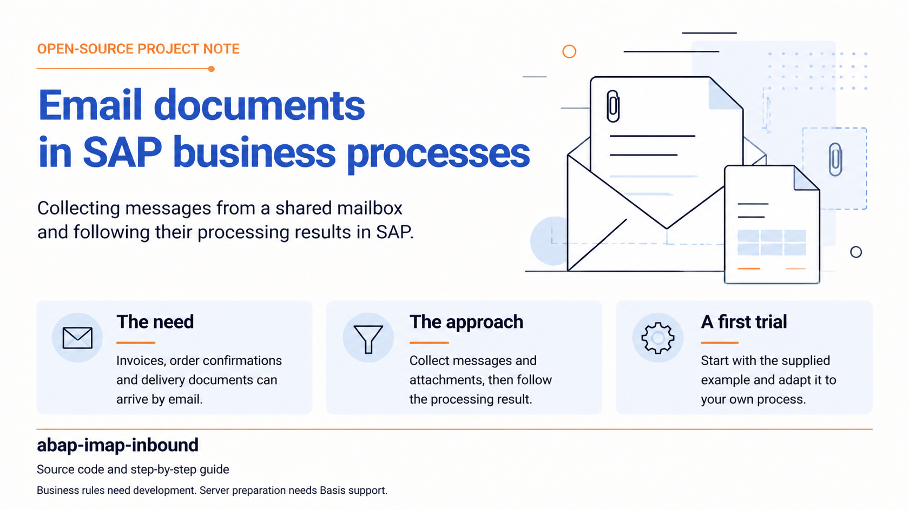

# abap-imap-inbound

> **English** | [Türkçe](README.tr.md)

An open-source project for collecting documents sent by email and tracking processing results inside SAP.

## What does it help with?

Imagine suppliers sending invoices or delivery documents to a shared email address. Someone opens each message, downloads its attachments and prepares them for use in SAP. This project provides a starting point for automating the collection of those messages and attachments.

- Retrieves messages and attachments from the mailbox you select.
- Shows which messages were processed successfully and which encountered errors in SAP.
- Moves successfully processed messages to a separate folder in the mailbox.

You can try this flow with the supplied example. A developer adds business actions such as creating invoices, reading amounts from PDFs or attaching documents to purchase orders according to your needs.

## Who can use it?

You do not need to be a developer to try the example, enter mailbox settings or inspect results. A functional consultant or process owner can coordinate setup.

Setup needs help from **SAP system administration (Basis)** and your **email administrator**. An **ABAP developer** helps install the SAP programs and add your business rules.

## What should you know before starting?

Use a **separate test mailbox** dedicated to the trial. Processing may mark messages as read and move them to another folder.

**Your email address and correct password may not be enough to connect.** The account must allow IMAP access: permission for another program to read the mailbox. Being able to sign in through Outlook or webmail does not prove this access is available. Ask your email team to confirm that the account can connect with this project. Some accounts require sign-in methods this version does not support; see the separate guide for [detailed connection requirements](docs/TECHNICAL-REFERENCE.md#before-you-start-is-your-mailbox-suitable).

### Where is mail read from, and where does it go?

- **Folder to read:** The default is the **inbox (`INBOX`)**. If you want to collect mail from a specific folder instead, enter that folder's name in the settings. For example, selecting an existing `Invoices` folder reads only the messages there.
- **Processed folder:** Choose the mail folder for successfully processed messages in the settings. You can use an existing folder. `SAP-Processed` is just the initial example name; you do not need to create a new folder with that name.

Both folders belong to **the same email account**. You do not need to create folders in SAP or on your computer's disk.

## How can you get started?

1. **[Open the step-by-step installation guide](docs/WALKTHROUGH.md).** It explains how to download the files, which team supplies each setting and what to do on the screens.
2. **Complete setup with your team and try the supplied example.** Send a test email with a small attachment, then inspect the result and attachment in SAP.
3. **Agree your own business process.** For example, decide with your consultant and developer which purchase order an incoming document should belong to.

## Further reading

| What you need | Guide |
|---|---|
| Installation and first use | [Step-by-step walkthrough](docs/WALKTHROUGH.md) |
| Connection requirements, permissions, technical limits and test status | [Technical reference](docs/TECHNICAL-REFERENCE.md) |
| Code examples for adding your business action | [Developer guide](docs/TECHNICAL-GUIDE.md) |

**Current source version: 1.1.0.** Installation and runtime tests for this version on an actual SAP system are still pending. Evaluate it in a test system first; the technical reference describes [what has been tested](docs/TECHNICAL-REFERENCE.md#what-has-been-verified).

## License

[MIT](LICENSE) — you may use, modify and share the project under the license terms.
