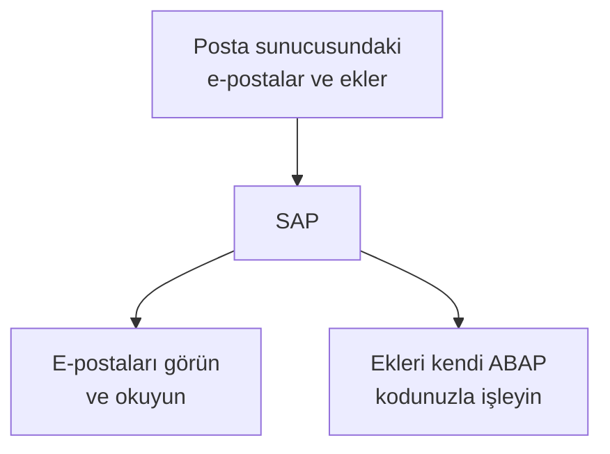
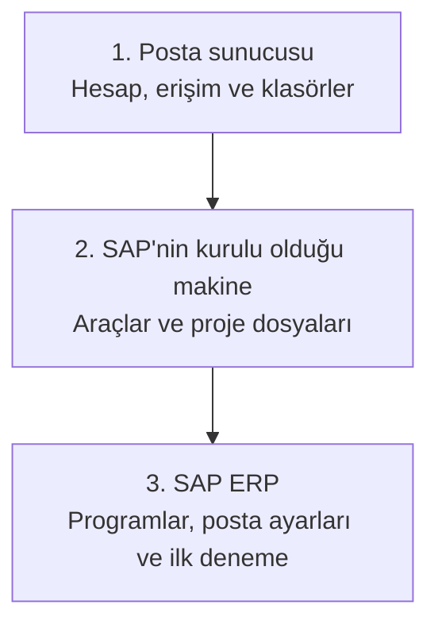

# abap-imap-inbound

> [English](README.md) | **Türkçe**

Bir posta sunucusundaki e-postaları **SAP'de görmek ve okumak, eklerini almak ve işlemek** istiyorsanız bu projeyi kullanabilirsiniz. Eklerle yapılacak iş adımını kendi ABAP kodunuzla tanımlarsınız.

Kurulumu yapacak kişinin **SE38'de program oluşturabildiği, etkinleştirebildiği ve çalıştırabildiği** varsayılır. Önce bir deneme SAP sistemi ve deneme posta kutusuyla başlayın.

## Büyük resim: kurulum üç bölümden oluşur

**Bu projenin kurulumunun tamamlanması için üç bölümün hazırlanması gerekir:**

1. **Posta sunucusu:** SAP'nin okuyacağı posta hesabını ve bağlantı izinlerini hazırlarsınız.
2. **SAP'nin kurulu olduğu makine:** Postayı alacak yardımcı araçları ve proje dosyalarını hazırlarsınız.
3. **SAP ERP:** ABAP programlarını kurar, posta bilgilerini girer ve işlemi SAP'den çalıştırırsınız.

Bunlar üç ayrı makine kurmanız gerektiği anlamına gelmez. İkinci bölüm SAP sunucusunun Windows/Linux tarafı, üçüncü bölüm aynı sistemin SAP ekranlarından yaptığınız işlemlerdir. Posta hizmetiniz de zaten kullandığınız bir hizmet olabilir.

### Kurulum haritası

Aşağıdaki harita hazırlık sırasını gösterir. Her bölümün ayrıntısı hemen altında açıklanıyor.

## 1. Posta sunucusunda ne yapacaksınız?

SAP'nin hangi posta hesabına bağlanacağını ve hangi klasörü okuyacağını belirleyeceksiniz. Hesap size ait olabilir; yine de **doğru e-posta adresi ve parola tek başına yeterli olmayabilir**. Hesabın IMAP erişimine, yani başka bir programın iletileri okumasına izin vermesi gerekir. Giriş yöntemi de bu projeyle uyumlu olmalıdır.

Varsayılan olarak **Gelen Kutusu (`INBOX`)** okunur. İsterseniz başka bir klasör seçebilirsiniz. Başarıyla işlenen iletiler için aynı posta hesabında farklı bir hedef klasör seçin. `SAP-Processed` örnek başlangıç adıdır; bu adla yeni klasör açmak zorunda değilsiniz.

**Bu bölüm hazır olduğunda:** Gerçek posta sunucusu adı, port, güvenlik türü, giriş bilgileri ve iki klasörün adları elinizde olmalı. Posta hesabını siz yönetiyorsanız bunları kendiniz kontrol edin; başka ekip yönetiyorsa e-posta yöneticisinden veya sağlayıcı desteğinden alın.

[Posta hesabını hazırlama adımları →](docs/tr/WALKTHROUGH.md#1-posta-sunucusunu-hazırlayın)

## 2. SAP'nin kurulu olduğu makinede ne yapacaksınız?

Bu proje e-postayı almak için **PowerShell** ve **curl** kullanır. PowerShell proje komutlarını çalıştırır; curl posta sunucusuna bağlanır. Bu araçlar ve projenin sunucu dosyaları, **SAP'nin çalıştığı Windows/Linux makinede** hazırlanır. SAP GUI'yi açtığınız bilgisayar farklı olabilir.

Araçlar zaten uygunsa tekrar kurulmaz. Projenin sunucu kurulumuyla, iletilerin ve eklerin tutulacağı korumalı çalışma klasörü de hazırlanır.

**Bu bölüm hazır olduğunda:** Sunucu testi başarılı olmalı; kullanacağınız SAP sunucusunu ve çalışma klasörünün tam yolunu bilmelisiniz. Yönetim yetkiniz varsa RDP/SSH ile bağlanıp hazırlığı yapabilirsiniz; yoksa Basis veya sunucu yöneticisinden isteyin.

[Makineyi hazırlama adımları →](docs/tr/WALKTHROUGH.md#2-sapnin-kurulu-olduğu-makineyi-hazırlayın)

## 3. SAP ERP içinde ne yapacaksınız?

SE38'de `ZIMAP_INSTALL` programını oluşturup etkinleştirecek ve çalıştıracaksınız. Bu program, projenin ihtiyaç duyduğu SAP programlarını ve tablolarını oluşturur.

Ardından `ZIMAP_CONFIG` içinde ilk bölümde hazırladığınız posta bağlantı bilgilerini kaydedersiniz. Bu ayarların birlikte kaydedildiği tanıma **profil** diyoruz. İkinci bölümde hazırladığınız sunucu ve klasör de SAP kurulumu tarafından kullanılır.

**Bu bölüm hazır olduğunda:** SAP kurulum kontrolleri ve posta bağlantı testi başarılı olmalı. Bu SAP adımlarını kendi geliştirme yetkinizle siz yaparsınız.

[SAP ERP kurulum adımları →](docs/tr/WALKTHROUGH.md#3-sap-erp-içindeki-kurulumu-yapın)

## Üç bölüm hazırsa ilk denemeyi yapın

Küçük bir ek içeren deneme e-postası gönderin. Önce `ZIMAP_INBOUND` ile **yalnız listeleme** yapın; sonra hazır örnekle normal işleme geçin. `ZIMAP_MONITOR` içinde sonucu ve eki, posta hesabında da iletinin seçtiğiniz hedef klasöre taşındığını kontrol edin.

Hazır örnek bu temel akışı denetler. Fatura oluşturma, PDF'den tutar okuma veya eki bir siparişe bağlama gibi kendi iş adımlarınızı ayrıca eklersiniz.

[İlk denemeyi adım adım yapın →](docs/tr/WALKTHROUGH.md#4-üç-bölümü-birlikte-deneyin)

## Hangi rehberi açmalısınız?

- [Kurulum rehberi](docs/tr/WALKTHROUGH.md): Üç bölümü sırayla hazırlayın ve ilk e-postayı işleyin.
- [Sunucu ve posta yönetimini kendiniz yapacaksanız](docs/tr/SELF-MANAGED-SETUP.md): RDP/SSH, dosya aktarımı ve yönetim paneli adımları.
- [Geliştirici rehberi](docs/tr/TECHNICAL-GUIDE.md): Kendi ABAP iş mantığınızı ekleyin.
- [Teknik başvuru](docs/tr/TECHNICAL-REFERENCE.md): Ayrıntılı koşullar, yetkiler, sınırlar ve test durumu.

**Güncel kaynak: 1.1.0.** Güncel sürümün gerçek SAP kurulum/çalışma kabul testleri henüz tamamlanmadı. [Doğrulama durumu](docs/tr/TECHNICAL-REFERENCE.md#neler-doğrulandı).

[MIT lisansı](LICENSE) kapsamında kullanabilir, değiştirebilir ve paylaşabilirsiniz.
