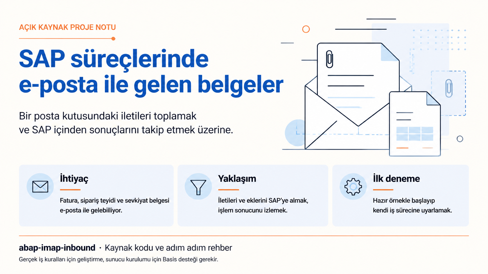

# abap-imap-inbound

> [English](README.md) | **Türkçe**

SAP'nin gelen mailleri alıp iş sürecinize aktarmasını sağlayan, ayrı bir entegrasyon sunucusu gerektirmeyen bir araç.



Tedarikçilerin faturalarını gönderdiği ortak bir posta kutusu düşünün. Bir kişi her maili açıyor, PDF'i kaydediyor ve SAP'deki ilgili işleme ekliyor. Bu proje maili toplama adımını otomatikleştirir: SAP posta kutusunu kontrol eder, metni ve ekleri alır, sizin ABAP iş mantığınızı çağırır ve sonucu kaydeder.

Bir ekin hangi siparişe bağlanacağı gibi iş kurallarını siz belirlersiniz. Proje; posta kutusuna bağlantıyı, dosyaları hazırlamayı, işleme akışını ve izleme ekranını sağlar.

**Güncel kaynak:** sürüm **1.1.0**, betik protokolü **2**. Kurulum ve ilk kullanım için [adım adım rehberle](docs/tr/WALKTHROUGH.md) başlayın.

## Size uygun yerden başlayın

Hazır örneği denemek, ayarları yapmak veya sonuçları izlemek için yazılımcı olmanız gerekmez. Bir modül danışmanı Basis desteğiyle kurulumu koordine edebilir. [Adım adım rehber](docs/tr/WALKTHROUGH.md); terimleri, hangi alana ne girileceğini, başarılı sonucun nasıl anlaşılacağını ve hata durumunda kimden destek alınacağını açıklar.

| Ne yapmak istiyorsunuz? | Nereden başlamalı? |
|---|---|
| İş sürecime uygun mu anlamak | Aşağıdaki kullanım örnekleri. |
| Hazır örneği denemek, posta kutusu tanımlamak veya sonuçları izlemek | [Adım adım kurulum ve kullanım](docs/tr/WALKTHROUGH.md). |
| Sunucuyu, yetkileri ve transport sürecini hazırlamak | [Basis hazırlığı](docs/tr/WALKTHROUGH.md#0-sunucuyu-hazırlayın-basis) ve [paket/transport](docs/tr/WALKTHROUGH.md#2b-canlıya-çıkmadan-önce-paket-ve-transport). |
| Kendi iş adımını bağlamak | [Handler örneği içeren geliştirici rehberi](docs/tr/TECHNICAL-GUIDE.md). |

## Hangi işlerde kullanılabilir?

Tedarikçi faturaları, sipariş teyitleri, sevkiyat belgeleri ve hizmet talepleri e-postayla gelebilir. Proje bu iletileri toplamak ve başlarına ne geldiğini izlemek için ortak bir temel sağlar. Bir belgeyi eklemek, referans doğrulamak veya belirlenmiş bir iş akışını başlatmak için kurumunuza özel kuralların geliştirilmesi gerekir.

Önce hazır örnekle toplama ve izlemeyi deneyin. Ardından gerçek iş davranışını modül danışmanı ve ABAP geliştiricisiyle belirleyin.

## Neler yapar?

- IMAP posta kutusundaki gönderen, alıcı, konu, metin ve ekleri okur.
- Her maili, ne yapılacağına karar veren ABAP programınıza (**handler**) iletir.
- Başarıyla işlenen maili `SAP-Processed` gibi bir klasöre taşır.
- İşlem sonuçlarını, mail içeriğini ve ekleri `ZIMAP_MONITOR` içinde gösterir.
- Hatalı mailleri kontrollü yeniden işlemeye bırakır; yarım kalan taşımayı, tamamlanmış handler'ı bilerek tekrar çağırmadan sürdürür.

Paketle gelen handler bir örnektir. Fatura oluşturma, PDF içinden değer çıkarma veya iş nesnesine belge ekleme gibi işlemleri kendi handler'ınıza eklersiniz.

## Mevcut bir posta kutusunu neden okuyalım?

Tedarikçi faturaları, sipariş onayları ve lojistik belgeleri hâlâ sıkça maille gelir. Özellikle eski sistemlerde veya kapalı ağlarda, mevcut ortak posta kutusu zaten iş sürecinin bir parçası olabilir.

SAP, SAPconnect/SMTP üzerinden kendisine iletilen mailleri de alabilir. Bu projedeki akışta ise SAP, mevcut bir posta kutusunu belirli aralıklarla kontrol edip içeriğini getirir. SAP'nin kendi SMTP yolu için [gelen ileti akışına](https://help.sap.com/saphelp_snc700_ehp01/helpdata/en/2b/d9260b4b8a11d1894c0000e8323c4f/content.htm?no_cache=true) bakabilirsiniz.

İş, SAP'nin kurulu olduğu Windows veya Linux makinede—**uygulama sunucusunda**—yapılır. SAP, **SM69** üzerinden izin verilmiş bir sunucu komutunu başlatır; PowerShell ve `curl` posta kutusuna bağlanıp mailleri dosya olarak hazırlar. Ayrı bir middleware sunucusu gerekmez. PowerShell ve IMAPS destekli `curl`, makinede yoksa kurulmalıdır.

## Sisteminize uygun mu?

Proje, Basis'in sunucu dosyalarını kurabildiği ve dış komutları tanımlayabildiği klasik bir ABAP kurulumu için tasarlandı. Şu koşullarda yararlı olabilir:

- İş süreci için ayrılmış bir posta kutusu kullanıyorsunuz.
- Mail sunucusu kullanıcı adı/şifreyle girişe izin veriyor ve **UID MOVE** destekliyor.
- SAP uygulama sunucusu mail sunucusuna erişebiliyor.
- İş mantığını yazacak bir geliştirici, izin ve sertifikaları yönetecek Basis desteği var.

Kaynaklar, **4.6C–7.5x** hedefi için eski ABAP sözdizimiyle yazıldı. Bu bir uyumluluk sertifikası değildir: eski ve Unicode olmayan SAP sürümlerinde henüz doğrulanmadı. Bkz. [neler doğrulandı](#neler-doğrulandı).

OAuth desteği yoktur; OAuth gerektiren hesaplar bu sürümle kullanılamaz. `COPY` alternatifi kapalıdır; sunucunun UID MOVE desteklemesi gerekir.

## Nasıl çalışır?

| Program | Kullanan kişi ne yapar? |
|---|---|
| `ZIMAP_INSTALL` | Projenin SAP nesnelerini ve SM69 komutlarını kurar veya günceller. |
| `ZIMAP_CONFIG` | Posta kutusunu, kimlik bilgilerini, sınırları ve handler'ı tanımlar. |
| `ZIMAP_INBOUND` | Test modunda uygun mailleri listeler; normal çalışmada işler. Genellikle arka plan job'ı olarak planlanır. |
| `ZIMAP_MONITOR` | Sonuçları ve mail içeriğini gösterir, ekleri indirir, hatalı mailleri yeniden işlemeye işaretler. |
| `ZIMAP_HANDLER_DEMO` | Handler arayüzünü ve bilerek hata üreten bir örneği gösterir. Kendi iş mantığınız için kopyalanır. |

Normal çalışmada mailler listelenir, uygun mail indirilir, handler çağrılır, sonuç kaydedilir ve mail taşınır. Handler'ın başarısı taşımadan önce kaydedilir. Taşıma veya yerel arşivleme yarıda kalırsa sonraki çalışma bu adımı tamamlamayı dener.

Bu davranış, handler'ın işlem sözleşmesine uymasına bağlıdır. SAP işlemi dışındaki etkiler için handler'ın kendi tekrar kontrolü gerekir; koşulsuz “tam bir kez işlenir” garantisi verilmez.

## Kurulum

[Adım adım rehber](docs/tr/WALKTHROUGH.md), gerekli bilgileri, ekranları ve beklenen kontrolleri anlatır. Kurulum üç ana aşamadan oluşur:

### 1. Basis uygulama sunucusunu hazırlar

Windows'ta **Windows PowerShell 5.1**, Linux'ta **PowerShell 7** gerekir. Her iki sistemde de `curl` çıktısındaki protokol listesinde `imaps` bulunmalıdır. Paketi açtığınız klasörden:

**Windows — yönetici PowerShell oturumu:**

**Bu komut bloğu çalışırken üç bilgiyi size sorar:** gerçek IMAP sunucu adı (posta ekibi), Windows SAP servis hesabı ve tam çalışma klasörü yolu (Basis). Her sorunun karşısına kendi sisteminizin değerini yazıp Enter basın. Boş bilgiyle kurulum başlamaz. `-AllowedHosts` bağlanılmasına izin verilen posta sunucusudur; aynı adı SAP profilindeki **Server / Sunucu** alanına da girin. Parola veya e-posta adresi bu alana yazılmaz.

**Bloğun tamamını süslü parantezleriyle birlikte kopyalayın.** Sorulara kendi değerlerinizi tırnak eklemeden yazın. Her blok gerekli bilgileri yeniden sorar.

```powershell
& {
  $ImapHostName = (Read-Host 'Posta ekibinin verdigi IMAP sunucu adi').Trim()
  $SapOsAccount = (Read-Host 'Basis tarafindan dogrulanan Windows SAP servis hesabi').Trim()
  $ImapRoot = (Read-Host 'Basis tarafindan onaylanan tam calisma klasoru yolu').Trim()
  if (@($ImapHostName, $SapOsAccount, $ImapRoot) -contains '') {
    throw 'Bilgiler bos birakilamaz. Ilgili ekipten alip tekrar calistirin.'
  }
  powershell.exe -NoProfile -ExecutionPolicy Bypass -File server\setup-server.ps1 `
    -AllowedHosts $ImapHostName -SapAccount $SapOsAccount -Root $ImapRoot
}
```

**Linux — Bash içinde çalıştırın.** Bu blok gerçek IMAP sunucusunu, Linux SAP kullanıcısını ve Basis'in onayladığı tam klasör yolunu sorar. Sorulara kendi sisteminizin bilgileriyle yanıt verin; boş değerle kurulum başlamaz.

```bash
{
  read -r -p 'Posta ekibinin verdigi IMAP sunucu adi: ' imap_host
  read -r -p 'Basis tarafindan dogrulanan Linux SAP kullanicisi: ' sap_os_user
  read -r -p 'Basis tarafindan onaylanan tam calisma klasoru yolu: ' imap_root
  sudo bash server/setup-server.sh \
    --allowed-hosts "${imap_host:?IMAP hostname is required}" \
    --sap-user "${sap_os_user:?SAP OS user is required}" \
    --root "${imap_root:?Working folder is required}"
}
```

Kurulum **hem** `imap.ps1` hem `mime.ps1` dosyasını kopyalar; çalışma klasörlerini oluşturur, erişimi sınırlar ve Basis politikasını yazar. Varsayılan kök dizinler `C:\sapimap` ve `/usr/sap/sapimap`'tir. Üst dizinler kurulumun sahiplik ve izin denetimlerini karşılamalıdır; kısa, yöneticilerin kontrolündeki bir yol kullanın.

### 2. Geliştirici SAP nesnelerini kurar

**SE38**'de `ZIMAP_INSTALL` adında çalıştırılabilir program oluşturun. [Üretilmiş kaynağın](ZIMAP_INSTALL.abap) tamamını yapıştırın, etkinleştirin ve çalıştırın. Sunucu klasörünü kontrol edin; son sunucu testi seçili kalsın.

Kalıcı geliştirme için `ZIMAP` gibi bir müşteri paketi kullanın. `$TMP` denemeye uygundur; installer bir pakete kaydedilse bile ürettiği nesneleri şu anda `$TMP` içine koyar. Canlı kullanımdan önce geliştirme ve Basis ekibiyle [paket ve transport adımlarını](docs/tr/WALKTHROUGH.md#2b-canlıya-çıkmadan-önce-paket-ve-transport) uygulayın.

Kurulum, projenin DDIC nesnelerini ve programlarını oluşturur, sözdizimini denetler, SM69 komutlarını tanımlar; sunucu sürümünü, protokolünü ve kök dizinini kontrol eder. Kurulum ayarları başarılı denetimlerden sonra kaydedilir. Var olan ve farklı kaynakları güncellemek için **Overwrite existing programs** açıkça seçilmelidir.

### 3. Yönetici posta kutusu profilini tanımlar

`ZIMAP_CONFIG` içinde sunucuyu, kullanıcıyı, klasörleri ve handler'ı girin. Sertifika doğrulaması açık kalsın; taşıma yöntemini `MOVE` seçin. Şifreyi `S` kaynağıyla girin veya Basis'in yönettiği `O` kaynağını kullanın. **F8**, yeni profil revizyonunu kaydeder ve bağlantıyı test eder.

**`O` kaynağı için:** Aşağıdaki blok kendi sisteminizin tam profil anahtarını, Windows SAP servis hesabını ve kurulumda kullandığınız klasörü sorar. Anahtar `SID_CLIENT_PROFILE` biçimindedir: SID ve mandantı SAP'de **Sistem → Durum**, profil adını `ZIMAP_CONFIG` ekranından alın. `A4H_001_INVOICE` yalnız biçim örneğidir; aynen kopyalamayın. Parolayı daha sonra kurulum aracı ayrıca sorar.

```powershell
& {
  $ProfileKey = (Read-Host 'Bu sistem ve mandant icin tam SID_CLIENT_PROFILE anahtari').Trim()
  $SapOsAccount = (Read-Host 'Basis tarafindan dogrulanan Windows SAP servis hesabi').Trim()
  $ImapRoot = (Read-Host 'Basis tarafindan onaylanan tam calisma klasoru yolu').Trim()
  if (@($ProfileKey, $SapOsAccount, $ImapRoot) -contains '') {
    throw 'Bilgiler bos birakilamaz. Ilgili ekipten alip tekrar calistirin.'
  }
  powershell.exe -NoProfile -File server\setup-server.ps1 `
    -SetPassword $ProfileKey -SapAccount $SapOsAccount -Root $ImapRoot
}
```

Linux karşılığı ve ekran alanlarının açıklamaları [adım adım rehberdedir](docs/tr/WALKTHROUGH.md#3-posta-kutusu-profilini-tanımlayın).

## İlk kullanım

1. `ZIMAP_INBOUND`'u **List only (no downloads/changes)** seçili çalıştırın. Uygun maillerin UID'lerini listeler; maili indirmez veya içeriğini göstermez, handler çağırmaz, mail taşımaz ve yerel arşivi temizlemez.
2. Test posta kutusunda `ZIMAP_HANDLER_DEMO` ile normal bir çalışma yapın. Böylece gerçek iş belgesi oluşturmadan indirme, ayrıştırma, kayıt ve taşıma akışı denenir.
3. `ZIMAP_MONITOR`'dan sonuçları inceleyin; ardından kendi handler'ınızı bağlayıp test edin.
4. Basis, job'ı kurulumun yapıldığı **aynı uygulama sunucusunda** çalışacak şekilde planlasın. Yapılandırma ve izleme de o sunucudaki dosyaları kullanır.

Normal indirme maili okunmuş işaretleyebilir. Başarılı işlem maili başka klasöre de taşır; bu nedenle entegrasyona ayrılmış bir posta kutusu kullanın.

Monitör; PDF, PNG, JPG/JPEG, GIF, BMP ve TXT dosyalarını ilişkili görüntüleyiciyle açar. Excel dosyaları ve orijinal `.eml` dahil diğer türler **yalnızca indirilir**. Yetkili kullanıcı, hatalı mailleri yeniden işlemeye işaretleyebilir.

## Yetkiler ve işletim sınırları

Basis, yetkileri ilgili kullanıcılara ve tablo yetki gruplarına göre tanımlar. Uygulama tablo erişimini `VIEW_AUTHORITY_CHECK` ile denetler; dosya ve komut yetkileri ayrıca kontrol edilir.

| Rol | Gerekli erişim |
|---|---|
| Job kullanıcısı | `ZIMAP_PROFILE` görüntüleme; `ZIMAP_LOG` değiştirme; `S_LOG_COM` üzerinden `ZIMAP_LIST`, `ZIMAP_FETCH`, `ZIMAP_DONE`; `S_DATASET` üzerinden gelen mail dosyalarını okuma; handler'ın ihtiyaç duyduğu yetkiler. |
| Profil yöneticisi | `ZIMAP_PROFILE` görüntüleme/değiştirme; `ZIMAP_TEST` çalıştırma; `ZIMAP_CONFIG` için profil ve kimlik bilgisi dosyalarına `S_DATASET` yazma erişimi. |
| İzleme kullanıcısı | `ZIMAP_LOG` görüntüleme; `ZIMAP_MONITOR` için gelen/arşiv dosyalarını okuma. Yeniden işleme ayrıca `ZIMAP_LOG` değiştirme yetkisi gerektirir. |
| Kurulumu yapan | Proje nesneleri için geliştirme yetkileri ve SM69 komutlarını yönetip test etme yetkileri. Kaldırmada ek client kontrolleri vardır. |

- Proje şifreleri **kendi SAP tablolarına yazmaz**. Kimlik bilgileri işletim sistemi izinleriyle korunan düz metin dosyalardır; SAP servis hesabı ve ayrıcalıklı yöneticiler erişebilir. Uygulama kaydedilmiş şifreyi göstermez.
- SAP'den şifre girişinde normal varyant kaydetme ve yazdırma kapatılır. Gerekli koruma API'si yoksa yeni şifre girişi kapanır; Basis'in yönettiği `O` kaynağını kullanın.
- İzinli mail sunucuları, TLS istisnaları, boyut sınırları ve zaman aşımı `bin/policy.psd1` içinde Basis tarafından belirlenir. SAP servis hesabının `bin` erişimi okuma/çalıştırmayla sınırlıdır.
- Profil dosyaları sistem, client ve profil adına göre ayrılır; revizyon olarak yayımlanır. Mail geçmişi olan profil başka posta kutusuna yönlendirilemez veya silinemez; devre dışı bırakıp yeni profil oluşturun.
- Kurulum tek bir uygulama sunucusuna bağlıdır. Yerel dosyalar uygulama sunucuları arasında otomatik paylaşılmaz.
- Saklama süresi dolan uygun, tamamlanmış **yerel arşivler** normal çalışma sırasında temizlenir. Salt okunur test modu bu temizliği yapmaz. Bu işlem `ZIMAP_LOG` kayıtlarını veya uzaktaki işlenenler klasörünü silmez.

## Bilinen sınırlar

- Klasör adlarında ASCII harf, rakam ve `. _ / -` kullanılır; boşluk olmaz. Eski mail sunucularıyla uyum için ASCII şifre tercih edin.
- İlk `text/plain` bölüm metin olarak alınır; yoksa HTML düz metne çevrilir. S/MIME çözme ve `winmail.dat` açma desteği yoktur.
- Bozuk veya desteklenmeyen MIME, aşırı iç içe yapı/parça sayısı ve SAP dosya biçimine sığmayan metadata, tamamlanmış gibi gösterilmek yerine reddedilir.
- Monitör sorgu başına en fazla 1.000 satır gösterir. Gerektiğinde tarih, profil veya durum seçimini daraltın.

## Neler doğrulandı?

Aşağıdaki ayrım **1.1.0 kaynakları** için geçerlidir:

| Alan | Kanıt |
|---|---|
| Ayrıştırıcı ve IMAP akışı | Windows PowerShell 5.1/7 ve Linux PowerShell 7.4 üzerinde GreenMail 2.1.14 ile yerel regresyon koşuları. Kimlik/revizyon, yeniden deneme, yarım kalan taşıma, retention, bozuk MIME ve boyut sınırlarını kapsar. |
| Linux kurulumu | SAP'yi temsil eden ayrı bir işletim sistemi hesabıyla izole konteynerde kurulum, self-test ve izin denetimleri. |
| Kaynak ve build | ABAP ASCII/72 sütun kontrolü, 7.02 hedefli sekiz dosyalık abaplint ayrıştırması, PowerShell ayrıştırması, Windows native yardımcı kodunun derlenmesi, Bash denetimleri ve tekrarlanabilir installer üretimi. |
| Gerçek SAP çalışma zamanı | Güncellenmiş 1.1.0 installer, ekran ve transaction akışları SAP üzerinde doğrulanmayı bekliyor. Mevcut ekran görüntüleri SAP ABAP Platform Trial 2025 üzerindeki 1.0 demosundan. |
| Eski/Unicode olmayan SAP | Uyumluluk hedefi; 4.6C–7.0 üzerinde doğrulanmadı. |
| Windows sunucu kurulumu | Güncellenmiş kurulum mantığı gerçek bir SAP Windows sunucusunda çalıştırılmadı. |

Kontroller elle çalıştırılır; depoda otomatik CI iş akışı bulunmaz. Ayrıştırma kontrolü SAP derleyicisinin veya çalışma zamanı testinin yerini tutmaz.

## Mevcut kurulumu güncelleme

Dosyaları değiştirmeden önce [güncelleme adımlarını](docs/tr/WALKTHROUGH.md#8-mevcut-kurulumu-güncelleyin) okuyun. 1.1.0; betik protokolünü, profil adlandırmasını ve revizyonlu dosya yapısını değiştirir.

SAP kaynaklarıyla **iki sunucu modülünü birlikte** güncelleyin. Profilleri yeniden kaydedin; `S` şifrelerini yeniden girin. Basis'in yönettiği kimlik bilgileri tam sistem/client/profil anahtarını kullanır. Eski mail dizinleri korunur, **otomatik taşınmaz**. Bekleyen `H` kayıtları ve dosyaları için kontrollü geçiş planı gerekir.

## Geliştirme testleri ve build

Node.js 22+ ve npm geliştirme araçlarıdır; SAP sunucusunda gerekli değildir. PowerShell 7 ile kaynak ve ayrıştırıcı kontrolleri:

```powershell
npm ci --ignore-scripts
pwsh -NoProfile -File test/check-source.ps1
pwsh -NoProfile -File test/run-tests.ps1 -Shell pwsh
```

IMAP paketi, SMTP/IMAPS ve REST API'si açık, geçici bir GreenMail örneği gerektirir. [CONTRIBUTING.md](CONTRIBUTING.md) elle başlatma ve test komutlarını içerir. Her koşu ayrı test kullanıcısı oluşturur; bu testleri iş posta kutusuna yönlendirmeyin.

ABAP kaynaklarını değiştirdikten sonra installer'ı yeniden üretin:

```powershell
pwsh -NoProfile -File installer/build.ps1
```

## Diğer rehberler

- [Adım adım kurulum, ilk kullanım ve güncelleme](docs/tr/WALKTHROUGH.md)
- [Geliştirici rehberi: handler'ı kendi sürecinizde kullanın](docs/tr/TECHNICAL-GUIDE.md)
- [Mimari arka plan](docs/tr/DESIGN.md)
- [Sunucu başvuru rehberi](docs/tr/SERVER-SETUP.md) ve [posta kutusu hazırlığı](docs/tr/MAILBOX-SETUP.md)

Güncel kurulum adımları walkthrough'tadır. Diğer başvuru rehberlerinin güncellemesi sürerken içlerinde 1.0 örnekleri bulunabilir.

## Lisans

[MIT](LICENSE)
