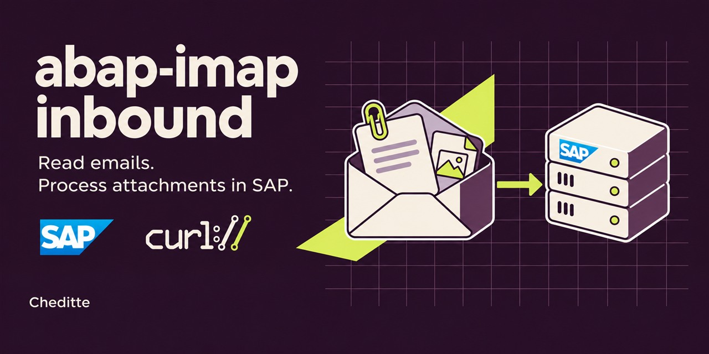
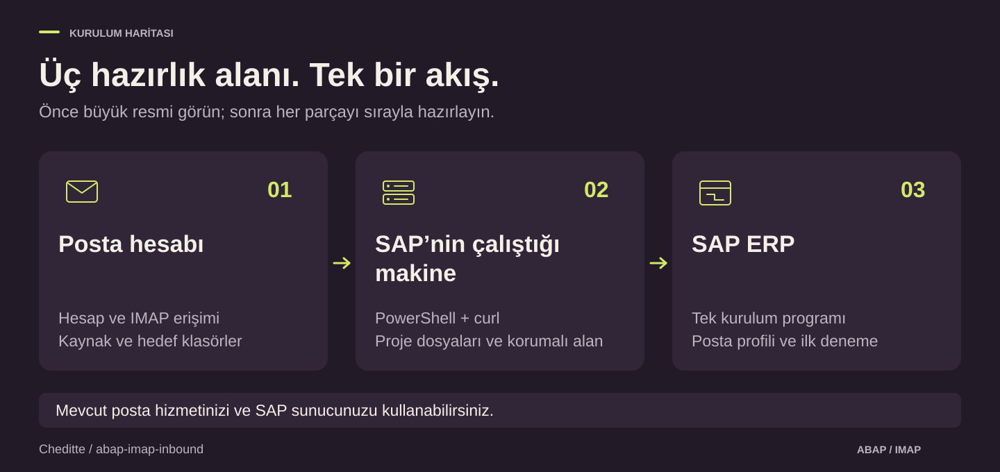

# SAP'de e-posta ve ek okuma

> [English](README.md) | **Türkçe**

**SAP tarafını tek kurulum programıyla hazırlayın; e-postaları ve eklerini SAP'den yönetin.**

Bir posta sunucusundaki e-postaları SAP'de okumak, eklerini almak ve kendi ABAP sürecinizde işlemek için bu projeyi kullanabilirsiniz. Hazır örnekle e-postayı ve eklerini SAP içinde açabilirsiniz. Ekleri bir belgeye bağlamak gibi kendi iş adımlarınızı ABAP koduyla eklersiniz.

## Kurulumun üç parçası

1. **Posta hesabı:** SAP'nin okuyacağı hesap, giriş yöntemi ve posta klasörleri hazırlanır.
2. **SAP'nin çalıştığı makine:** Maili getiren PowerShell ve curl araçları, proje dosyaları ve korumalı çalışma klasörü hazırlanır. SAP GUI'yi açtığınız bilgisayar farklı olabilir.
3. **SAP ERP:** `ZCHE_IMAP_INSTALL` SE38'de oluşturulur ve çalıştırılır. Ardından gerekli yetkiler ve posta bağlantı ayarları hazırlanır.

Bu, üç yeni sunucu kuracağınız anlamına gelmez. Mevcut posta hizmetinizi ve SAP sunucunuzu kullanabilirsiniz. SAP nesnelerini **tek kurulum programı** oluşturur; posta hesabı ve sunucu ayrıca hazırlanır. Ayrı PI/PO veya entegrasyon sunucusu gerekmez.

SE38'de program oluşturup etkinleştirebildiğiniz varsayılır. Sunucu ve posta yönetimi sizdeyse hazırlıkları da yapabilirsiniz; başka ekipteyse rehberde hangi bilgileri istemeniz gerektiği açıklanır. [Adım adım başlayın](docs/tr/WALKTHROUGH.md#hazirlik).

## Ne yapmak istiyorsunuz?

| Hedefiniz | Başlayacağınız yer |
|---|---|
| İlk kez kurmak | [Üç hazırlık ve SAP kurulumu](docs/tr/WALKTHROUGH.md#hazirlik) |
| Bağlantıyı ve gelen ileti listesini kontrol etmek | [Yol A — Yalnız listeleme](docs/tr/WALKTHROUGH.md#listeleme) |
| İlk maili ve ekini SAP'de açmak | [Yol B — İlk mail](docs/tr/WALKTHROUGH.md#ilk-mail) |
| Ekleri kendi ABAP kodumla işlemek | [Geliştirici rehberi](docs/tr/TECHNICAL-GUIDE.md) |
| Belirli aralıklarla otomatik çalıştırmak | [Yol C — Varyant ve job](docs/tr/WALKTHROUGH.md#otomatik) |
| Ekrandaki bir alanın ne olduğunu öğrenmek | [Alan rehberi](docs/tr/SCREEN-GUIDE.md) |

## Posta hesabınız uygun mu?

**Doğru e-posta adresi ve parola tek başına yeterli olmayabilir.** Hesap IMAP erişimine ve bu projenin kullandığı parola/uygulama şifresiyle girişe izin vermelidir. Microsoft 365 / Exchange Online ve yalnız OAuth kabul eden hesaplar bu sürümde desteklenmez. [Posta hesabı koşulları](docs/tr/TECHNICAL-REFERENCE.md#başlamadan-önce-posta-kutunuz-uygun-mu).

Varsayılan okuma klasörü **Gelen Kutusu (`INBOX`)**. İsterseniz başka bir klasör seçebilirsiniz. Başarıyla işlenen mailler aynı hesapta farklı bir klasöre taşınır. **`SAP-Processed` örnek addır; bu isimle klasör oluşturmak zorunlu değildir.** Seçtiğiniz hedef klasörün posta hesabında bulunması gerekir.

## İlk kullanımda ne olacak?

1. **Bağlantıyı kontrol edin:** List only / Yalnız listeleme ile uygun ileti numaralarını görün. Bu adım içerik veya ek indirmez.
2. **Bir deneme mailini işleyin:** hazır örnekle maili ve ekini alın. Başarılı mail seçtiğiniz hedef klasöre taşınır.
3. **Sonucu SAP içinde açın:** `ZCHE_IMAP_MONITOR` üzerinden mail gövdesini ve ekini inceleyin.

[SE38 kurulumundan SM36 job tanımına kadar görsellerle ilerleyin](docs/tr/WALKTHROUGH.md#kurulum).

Normal işleme maili okundu işaretleyebilir ve taşıyabilir. İlk kullanım için **deneme sistemi ve ayrı bir deneme posta kutusu** seçin.

## Durum ve ayrıntılar

**Güncel sürüm: [v0.9.2 — sürüm adayı](https://github.com/Cheditte/abap-imap-inbound/releases/tag/v0.9.2).** Proje sahibi, 3 Kasım 2026'da v0.9.2'yi SAP'de çalıştırıp sonuç aldığını doğruladı. Bu manuel doğrulama, bütün kabul senaryolarının tamamlandığı anlamına gelmez. Klasik ABAP 7.00 uyumluluğu bir hedeftir; ECC çalışma sertifikasyonu değildir. [Doğrulama kaydı](VALIDATION.md).

- [Kurulum ve kullanım](docs/tr/WALKTHROUGH.md) · [Alan rehberi](docs/tr/SCREEN-GUIDE.md)
- [Sunucuya kendiniz bağlanacaksanız](docs/tr/SELF-MANAGED-SETUP.md)
- [Teknik başvuru](docs/tr/TECHNICAL-REFERENCE.md) · [Yetkiler ve parola yönetimi](SECURITY.md)
- [Mevcut kurulumdan güncelleme](docs/tr/WALKTHROUGH.md#guncelleme) · [İsteğe bağlı abapGit](ABAPGIT.md)

[MIT lisansı](LICENSE) · [Değişiklikler](CHANGELOG.md) · [Katkı](CONTRIBUTING.md) · [Sorun bildir](https://github.com/Cheditte/abap-imap-inbound/issues)
