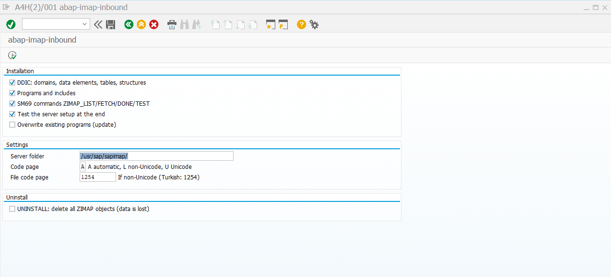

# Technical reference: connectivity, operations and tests

> **English** | [Türkçe](tr/TECHNICAL-REFERENCE.md) · [Project overview](../README.md) · [Installation](WALKTHROUGH.md) · [Code examples](TECHNICAL-GUIDE.md)

This file is for Basis and email teams preparing installation, and developers who want the details. It describes **1.1.0 sources and script protocol 2**. Use the [walkthrough](WALKTHROUGH.md) for installation in order, and the [developer guide](TECHNICAL-GUIDE.md) to add your business logic.

## Find the detail you need

- [Mailbox suitability](#before-you-start-is-your-mailbox-suitable)
- [Server setup commands](#server-setup-commands-and-checks)
- [SAP installation options](#sap-installation-options-and-checks)
- [Profile fields and password management](#profile-fields-and-server-managed-passwords)
- [Package and transport](#2b-before-production-package-and-transport)
- [Retention and retries](#retention-and-retry-details)
- [Upgrading an existing installation](#8-update-an-existing-installation)
- [Test status](#what-has-been-verified)

## Terms you may be seeing for the first time

| Term | Meaning in this project |
|---|---|
| IMAP | A connection method that lets a program read messages and folders on a mail server. |
| Profile | A saved set of mailbox server, user, folder and processing settings in SAP. |
| Handler | The ABAP program that decides what to do with each message. Use the supplied `ZIMAP_HANDLER_DEMO` for your first trial. |
| Application server | The Windows or Linux machine running SAP. Server installation commands run there, rather than on your own computer. |
| Background job | A program SAP runs automatically on a schedule, for example to check for mail regularly. |

## Before you start: is your mailbox suitable?

**Entering your email address and correct password may not be enough to connect.** Being able to sign in through webmail or Outlook does not mean this project can connect using the same details.

Ask your email administrator to confirm:

- **IMAP access is allowed for the account.** Your organization may disable or restrict it. For a shared mailbox, the connecting account must also have permission to access that mailbox.
- **The sign-in method is compatible with this project.** This version connects with a username and password. OAuth, which uses browser authorization or access tokens, is not supported. An account that only accepts OAuth cannot be used with this version.
- **With two-step verification, the normal password may not work.** Some providers offer a separate app password. Your email team must confirm whether that option is available for your account and approved by your organization; it is not available for every account. Conditions vary by provider; see, for example, [Microsoft's connection requirements](https://support.microsoft.com/en-us/outlook/pop-imap-and-smtp-settings-for-outlook-com) and [Google's app-password explanation](https://support.google.com/mail/answer/185833?hl=en).
- **The SAP server can reach the mail server.** A connection that works from your computer may be blocked by a firewall from SAP. Basis and the network team check this.
- **Moving messages is permitted and supported.** Successful messages are moved to another mail folder. The email team must confirm support for the required `UID MOVE` feature.

Use **a separate test mailbox dedicated to this trial** first. Normal processing may mark messages as read and move them to another folder.

### Which settings do you need?

| Setting | Where it comes from and where to use it |
|---|---|
| IMAP hostname | Obtain it from the email team and enter it in the SAP profile's **Server** field. It is not your email address or the SAP server name. |
| Port and connection security | The email team supplies these together. `993 / IMAPS` is a common example; use the values confirmed for your account. |
| Login username | Use the value supplied by the email team. It may differ from your email address. |
| Password | Use the password appropriate to the approved sign-in method. Keep it out of support tickets and screenshots. |
| Folder to read | The default `INBOX` reads the inbox. To read another folder, enter its actual IMAP name/path; only the selected folder is read. Confirm the IMAP name rather than using a translated display name. |
| Processed folder | The mail folder for successfully handled messages, explained below. |

Numbers and names above are examples. Use the real settings for your account; ask the responsible team instead of guessing an unknown value.

### How do you choose a processed folder?

Choose the destination for successfully processed messages in the SAP profile's **Processed folder** field. You can use an existing folder in the same mailbox. `SAP-Processed` is only the initial value; you do not need to create a new folder with that name.

Enter the selected folder's actual IMAP name/path. It must exist on the mail server; a local Outlook archive or disk folder cannot be used. If you prefer a new folder, ask your email administrator to prepare it.

Folder names accept English letters, digits and `. _ / -`, with no spaces or non-ASCII characters.

## Installation: what order should you follow?

This is a roadmap. The screens and commands are in the [step-by-step installation guide](WALKTHROUGH.md).

1. **Download the project files.** Use **Code → Download ZIP** on the repository home page and unpack the entire archive. Git is not required. Use server and SAP files from the same download.
2. **Prepare the test mailbox.** Obtain the settings above and select an existing mailbox folder for processed messages.
3. **Have Basis prepare the server.** Processing runs on the SAP application server. Two helper tools, PowerShell and `curl`, retrieve mail there; no separate integration server is needed. Basis prepares network access and a protected working folder, then gives you its full path. [Server preparation](WALKTHROUGH.md#1-prepare-the-server-basis).
4. **Install the SAP programs.** Someone with SAP development permission creates `ZIMAP_INSTALL` in the **SE38** program editor, loads the matching source file from this project and runs it. It creates the required SAP programs and tables. [SAP installation steps](WALKTHROUGH.md#2-create-the-installer-program).
5. **Save a mailbox profile.** In `ZIMAP_CONFIG`, choose a profile name and enter your actual server, user and folder settings. For the first trial, select `ZIMAP_HANDLER_DEMO` as the handler and `MOVE` as the move method. Password source `S` means entering the password in SAP; `O` means Basis saves it on the server. **F8** saves the settings and tests the connection; saved settings alone do not prove the connection works. [Mailbox profile setup](WALKTHROUGH.md#4-set-up-a-mailbox-profile).

For maintained use, your development team should create a **package**, such as `ZIMAP`: a group for managing related SAP development objects. The installer currently creates its objects in the local trial area `$TMP`; saving the installer in a package does not change that. Plan [package and transport steps](TECHNICAL-REFERENCE.md#2b-before-production-package-and-transport) with Basis and development to move the objects to test and production systems.

## What should you do in the first trial?

1. Send an email with a small PDF or text attachment to the test mailbox.
2. Open `ZIMAP_INBOUND` through **SE38** in SAP and enter the profile name you saved. Select **List only (no downloads/changes)** and run it. This lists eligible message numbers (`UID`); it does not show content or attachments, or move messages.
3. If listing succeeds, run the same test profile with `ZIMAP_HANDLER_DEMO`, this time **with List only cleared**. It now retrieves the message and attachments, records the example program's result and moves successful mail to the processed folder.
4. Open `ZIMAP_MONITOR` to inspect the result and attachments. A completed message has status `S`; it should also appear in the processed folder you selected in the mailbox.
5. After the trial, work with a developer to add your business rules. Ask Basis to schedule regular runs as a background job on the **same SAP application server** used for installation.

Do not expect the supplied example to create an invoice or purchase order in SAP. The trial checks the mail connection, file retrieval and viewing of results.

The monitor can open PDFs and common images using a suitable application on your computer. Other types, including Excel and the original email file (`.eml`), are downloaded for inspection. Authorized users can select failed messages for another processing attempt.

## Where should you start if the connection fails?

| What you see | Who should check it? |
|---|---|
| Correct email address and password, but sign-in is rejected | Email team: IMAP permission, actual login username, access to the mailbox and a supported sign-in method. |
| Server not found or connection timeout | Basis/network team: actual IMAP hostname, port and network access from the SAP server. |
| Certificate error | Basis/email team: hostname and trusted certificates. Keep certificate verification enabled. |
| Folder not found or messages cannot be moved | Email team: does the folder exist in that mailbox, is its name/path correct, and are move permission and `UID MOVE` support available? |
| SAP permission error | Basis/authorization team: the SAP user's program, file and command permissions. |
| Listing works but no content appears | **List only** shows message numbers. Use the normal trial with the supplied example to retrieve content. |

When asking for help, share the step and error text, without passwords. Detailed checks are in the [installation guide](WALKTHROUGH.md).

## Why read an existing mailbox?

This project has SAP periodically connect to an existing mailbox and collect messages. SAPconnect/SMTP provides another workflow, where mail is delivered to SAP. The choice depends on your requirements; see [SAP's inbound communication explanation](https://help.sap.com/saphelp_snc700_ehp01/helpdata/en/2b/d9260b4b8a11d1894c0000e8323c4f/content.htm?no_cache=true).

The source targets **4.6C–7.5x** compatibility on classical ABAP systems. This is not a certification; compilation and runtime tests on your target SAP release are required.

## Access and operating boundaries

Basis assigns permissions to the intended users and table authorization groups. The application checks table access with `VIEW_AUTHORITY_CHECK`; file and command permissions are additional checks.

| Role | Required access |
|---|---|
| Job user | Display `ZIMAP_PROFILE`; change `ZIMAP_LOG`; execute `ZIMAP_LIST`, `ZIMAP_FETCH`, `ZIMAP_DONE` through `S_LOG_COM`; read the input mail files through `S_DATASET`; handler-specific permissions. |
| Profile administrator | Display/change `ZIMAP_PROFILE`; execute `ZIMAP_TEST`; write profile and credential files through `S_DATASET` for `ZIMAP_CONFIG`. |
| Monitor user | Display `ZIMAP_LOG`; read input/archive files for `ZIMAP_MONITOR`. Retry additionally requires change access to `ZIMAP_LOG`. |
| Installer | Development permissions for the project objects and the permissions needed to maintain and test SM69 commands. Uninstall has additional cross-client checks. |

- The project does **not** put passwords in its SAP tables. Credentials are plain-text files protected by OS permissions, accessible to the SAP service account and privileged administrators. The application does not display saved passwords.
- SAP password entry disables ordinary variant saving and printing. If the required protection API is unavailable, new SAP password entry is disabled; use Basis-managed source `O`.
- Basis controls allowed mail hosts, TLS exceptions, size limits and timeouts in `bin/policy.psd1`. SAP's service account has read/execute access to `bin`.
- Profile files are separated by system, client and profile, and published as revisions. A profile with mail history cannot be repointed to another mailbox or deleted; deactivate it and create a new profile instead.
- The installation is pinned to one application-server host. It does not provide automatic sharing of local files across application servers.
- Retention expires eligible, completed **local archives** during normal processing. Read-only test mode does not expire them. It does not purge `ZIMAP_LOG` or delete mail from the remote processed folder.

## Known limits

- Folder names use ASCII letters, digits and `. _ / -`, with no spaces. Prefer ASCII passwords for interoperability with older mail servers.
- The first `text/plain` body is used; otherwise HTML is converted to plain text. S/MIME decryption and `winmail.dat` unpacking are not implemented.
- Malformed or unsupported MIME, excessive nesting/part counts, and metadata that cannot fit the SAP file format are rejected instead of being reported as complete.
- The monitor displays at most 1,000 rows per query. Narrow the date, profile or status selection when needed.

## What has been verified

The distinction below applies to the **1.1.0 sources**:

| Area | Evidence |
|---|---|
| Parser and IMAP flow | Local regression runs on Windows with PowerShell 5.1/7 and Linux with PowerShell 7.4, against GreenMail 2.1.14. Includes identity/revision checks, retries, interrupted moves, retention, malformed MIME and size limits. |
| Linux setup | Isolated container setup, self-test and permissions using a separate OS account representing SAP. |
| Source/build | ABAP ASCII/72-column checks, eight-file abaplint grammar check targeting 7.02, PowerShell parsing, Windows native-helper compilation, Bash checks and reproducible installer generation. |
| Actual SAP runtime | The updated 1.1.0 SAP installer, screens and transactions still require validation on SAP. Earlier screenshots show a 1.0 demo on SAP ABAP Platform Trial 2025. |
| Older/non-Unicode SAP | Compatibility target only; not verified on 4.6C–7.0. |
| Windows server setup | Updated setup logic has not been exercised on a real SAP Windows server. |

Checks are run manually; this repository does not include an automated CI workflow. A grammar check does not replace the SAP compiler or runtime tests.

## Updating an existing installation

Read the [upgrade procedure](TECHNICAL-REFERENCE.md#8-update-an-existing-installation) before replacing files. Version 1.1.0 changes the script protocol, profile namespacing and revision storage.

Update SAP and **both server modules together**. Re-save profiles and re-enter source `S` passwords; Basis-managed credentials use the full system/client/profile key. Old mail directories are preserved but **not automatically migrated**. Pending `H` records and their files need a controlled migration plan.

## Development tests and build

Node.js 22+ and npm are development tools; they are not required on the SAP server. Run commands from the repository root. For source checks and parser tests with PowerShell 7:

```powershell
npm ci --ignore-scripts
pwsh -NoProfile -File test/check-source.ps1
pwsh -NoProfile -File test/run-tests.ps1 -Shell pwsh
```

The IMAP suite needs a disposable GreenMail instance with SMTP, IMAPS and its REST API. [CONTRIBUTING.md](../CONTRIBUTING.md) contains the manual startup and test commands. Integration tests create a separate user for each run; do not point them at a business mailbox.

After changing ABAP sources, regenerate the installer:

```powershell
pwsh -NoProfile -File installer/build.ps1
```

## Server setup: commands and checks

The installation is pinned to one SAP application server; configuration, processing and monitoring must run on that server. Basis should provide the appropriate server-specific SAP connection. Project programs and SM69 commands are shared across clients; coordinate changes with other owners.

**How to use the commands:** copy the complete block for your operating system, including its opening and closing braces. At each prompt, enter only your own value and press Enter; do not add quotation marks or square brackets. Obtain hostname/port values from the mail team and the SAP account/folder from Basis. Each block asks for its own values again and does not depend on a previous terminal session. `ZIMAP_INSTALL`, `ZIMAP_CONFIG`, `ZIMAP_INBOUND`, `ZIMAP_MONITOR` and `ZIMAP_HANDLER_DEMO` are actual program names; keep them unchanged.

**Run these commands on the SAP application server, not on the consultant's laptop.** Use the current repository's `server` and `script` folders together. Setup deploys both `imap.ps1` and `mime.ps1`.

Check connectivity from that server. On Windows, for example:

**This block prompts for the actual hostname and port.** Enter the values supplied by the mail team and press Enter, not your email address or SAP server name. Blank values stop the connection test. Use the same IMAP hostname for setup's `-AllowedHosts` / `--allowed-hosts` and the SAP profile's **Server** field.

```powershell
& {
  $ImapHostName = (Read-Host 'IMAP hostname from the mail team').Trim()
  $ImapPort = (Read-Host 'IMAP port from the mail team').Trim()
  if (@($ImapHostName, $ImapPort) -contains '') {
    throw 'Values are required. Obtain them from the responsible team and run again.'
  }
  Test-NetConnection -ComputerName $ImapHostName -Port ([int]$ImapPort)
}
```

`TcpTestSucceeded : True` confirms a TCP connection, not login or certificate trust. A failure needs DNS, routing, firewall and mail-service checks by the server/network team. The required connection is outgoing from the SAP server to the IMAP port.

### Windows

Use PowerShell 5.1 or later and a curl build whose `curl.exe --version` output includes `imaps`. In Windows PowerShell, use `curl.exe`: `curl` can mean a different command.

Run this block from the repository folder in an administrator PowerShell session. At the prompts, enter the mail team's IMAP hostname and the Windows SAP account and full working folder confirmed by Basis. Blank answers stop setup.

```powershell
& {
  $ImapHostName = (Read-Host 'IMAP hostname from the mail team').Trim()
  $SapOsAccount = (Read-Host 'Windows SAP service account confirmed by Basis').Trim()
  $ImapRoot = (Read-Host 'Full working-folder path approved by Basis').Trim()
  if (@($ImapHostName, $SapOsAccount, $ImapRoot) -contains '') {
    throw 'Values are required. Obtain them from the responsible team and run again.'
  }
  powershell.exe -NoProfile -ExecutionPolicy Bypass -File server\setup-server.ps1 `
    -AllowedHosts $ImapHostName -SapAccount $SapOsAccount -Root $ImapRoot
}
```

At the account prompt, enter the full service account confirmed by Basis; `DOMAIN\SAPServiceA4H` only illustrates the format. Specifying it avoids ambiguity on machines with multiple SAP instances. For a curl installation outside the default location, Basis must supply `-CurlPath` with the full path to the actual `curl.exe` file on the server, quoting the path if it contains spaces.

The default root is `C:\sapimap`. The block above explicitly asks for the folder path; enter the one approved by Basis. Use the same path for self-tests, credential setup and SAP installation. Keep it short: SAP's root field allows 60 characters, and older external-command interfaces also limit the combined command parameters. Do not weaken parent-directory permissions to bypass a setup failure.

Run the self-test. When prompted, enter the same full folder path you used during setup:

```powershell
& {
  $ImapRoot = (Read-Host 'Full working-folder path approved by Basis').Trim()
  if (@($ImapRoot) -contains '') {
    throw 'Values are required. Obtain them from the responsible team and run again.'
  }
  powershell.exe -NoProfile -File (Join-Path $ImapRoot 'bin\imap.ps1') test
}
```

Success identifies `PROTOCOL 2`, `VERSION 1.1.0` and the chosen root, then ends in `OK`. An administrator's self-test is useful, but the later SAP installer check must pass under SAP's actual execution account too.

### Linux

Install PowerShell (`pwsh`) and curl with IMAPS support. The generated SM69 command expects `/usr/bin/pwsh`. Confirm the actual SAP execution user; `a4hadm` is an example.

Run this block in Bash from the repository folder. Obtain the hostname from the mail team and the Linux SAP execution user and full working folder from Basis; enter your own values at each prompt.

```bash
{
  read -r -p 'IMAP hostname from the mail team: ' imap_host
  read -r -p 'Linux SAP execution user confirmed by Basis: ' sap_os_user
  read -r -p 'Full working-folder path approved by Basis: ' imap_root
  sudo bash server/setup-server.sh \
    --allowed-hosts "${imap_host:?IMAP hostname is required}" \
    --sap-user "${sap_os_user:?SAP OS user is required}" \
    --root "${imap_root:?Working folder is required}"
}
```

The default root is `/usr/sap/sapimap`. If its parents are writable by a non-root user/group, setup rejects the path. Basis should select an approved root with protected parents, such as `--root /opt/sapimap` where appropriate, and use it throughout. Do not change ownership of existing SAP directories just to pass this check.

Test with the SAP execution user and chosen root. Answer both prompts with the Linux user and full folder path used during setup:

```bash
{
  read -r -p 'Linux SAP execution user confirmed by Basis: ' sap_os_user
  read -r -p 'Full working-folder path approved by Basis: ' imap_root
  sudo -u "${sap_os_user:?SAP OS user is required}" /usr/bin/pwsh \
    -NoProfile -File "${imap_root:?Working folder is required}/bin/imap.ps1" test
}
```

The result must identify protocol `2`, version `1.1.0` and the chosen root, then end in `OK`. It checks local prerequisites; SAP installation and mailbox access are checked later.

### Certificates and handover

Keep TLS certificate verification enabled. Basis must configure trust for the actual curl build, using its trust store or an approved CA file through `CaCert` in `bin/policy.psd1`. Windows Schannel and other curl TLS backends can use different trust mechanisms.

Basis hands over the root path, selected SAP host and confirmation of the self-test. No password belongs in this handover.

## SAP installation options and checks

In **SE38**, enter `ZIMAP_INSTALL` and choose **Execute (F8)**.



For a first installation in development:

| Option | What to select / expect |
|---|---|
| DDIC objects | Selected. Creates project tables, structures, data elements and domains. |
| Programs | Selected. Creates configuration, processing, monitoring, includes and the demo handler. |
| SM69 commands | Selected. Creates the commands SAP uses to start the script. |
| Server check | Selected and required. Confirms SAP can run the expected script version and root. |
| Overwrite programs | Use for an agreed update after backup/review; it can replace local changes. |
| Server folder | The exact root from Basis, such as `C:\sapimap\` or `/usr/sap/sapimap/`. |
| I/O mode / code page | Keep automatic mode unless the developer confirms another choice. These control older systems' file reading. |
| Uninstall | Leave unselected. It removes shared objects across clients; it is not a profile reset. |

Execute and read the entire result list. Continue only when selected steps and the final server check succeed. Otherwise, keep the output for Basis/development.

Development permissions are checked even in SM69/server-only mode. The installer restores backed-up program/text and SM69 entries when applicable, but it is not a full database transaction or system backup. Review DDIC changes and newly created objects after a failed update.

## 2b. Before production: package and transport

`$TMP` is suitable for an experiment; its objects do not enter the normal package transport route. For maintained use, ask development and Basis to use your organization's customer package and transport process.

1. **In development**, create a package such as `ZIMAP` using **SE21** or **SE80**, with the transport layer agreed by Basis.
2. Install and test there. The current installer generates its objects in `$TMP`.
3. Inventory the actual project objects: installer, programs/includes, tables/structures, data elements and domains, plus your custom handler. Do not blindly select unrelated objects matching `ZIMAP*`.
4. Reassign the project's objects through **SE03 → Change Object Directory Entries**, or the applicable **SE80 → Reassign** action. Assign the package and collect objects in a transport request. Verify it contains the definitions and dependencies, not only the installer.
5. Import to the **test system**, prepare its server and local settings, and repeat the first-run checks. Then follow the approved production import process.

**This package/transport procedure has not been tested end to end with this project.** Validate it in your landscape before relying on it.

Transporting ABAP objects does not install PowerShell, OS files, permissions or credentials. Basis must review target-system SM69 command paths and authorizations, and prepare profiles/credentials for the intended system and client.

Do not assume that server-only installer mode works in a locked production system: it still checks development authorization and source consistency. Agree and test target-system setup in advance; this guide does not require relaxing production change controls.

SAP references: [Object Directory and package reassignment](https://help.sap.com/docs/SAP_NETWEAVER_700/109ce05a6c531014b4e8fe6b0570a984/5738e06c4eb711d182bf0000e829fbfe.html), [maintaining external commands](https://help.sap.com/docs/SAP_NETWEAVER_AS_ABAP_752/b17bd20044a44edb9aa7830ee52ffac3/c43a607b505211d189550000e829fbbd.html?locale=en-US&state=PRODUCTION&version=7.52.latest).

## Profile fields and server-managed passwords

| Field | First-test example | Explanation |
|---|---|---|
| Profile / active | `INVOICE` / selected | Name for these settings; active profiles can be processed. |
| Server / port | Your actual IMAP hostname / port | Obtain both from the mail team; do not copy the example address. |
| Security / verify certificate | Mode supplied by the mail team / selected | Select `IMAPS` or `STARTTLS` to match the port. Keep verification enabled. |
| User | Your actual mailbox login | Enter the login supplied by the mail team, not the example email address. |
| Credential source | `S` or `O` | `S`: enter the password in SAP. `O`: Basis saves it on the server. |
| Folder to read | Default `INBOX` | Reads the inbox. To read another folder in the same mailbox, enter its actual IMAP name/path; only the selected folder is read. |
| Processed folder | Name of the mail folder you select | You can use an existing folder. Replace the initial `SAP-Processed` value with its actual IMAP name/path. |
| Move mode | `MOVE` | Requires UID MOVE support. |
| Handler program | `ZIMAP_HANDLER_DEMO` | Supplied demonstration; no business document creation. |
| Maximum mails | `50` | Example upper limit per run. |
| Maximum size | `20` | Example MiB per message; server policy can impose a lower limit. |
| Timeout | `120` | Example network timeout in seconds. |
| Retention | `30` | Days to retain eligible completed local archives, not SAP logs or remote mail. |

### Enter the password in SAP or ask Basis

For **source `S`**, enter the password in SAP. It is written to an OS-protected plain-text credential file, not a SAP table. Ordinary variant saving and printing are disabled for this entry. If SAP's required protection API is unavailable, new password entry is disabled: use source `O`. Do not enter a new password through a background variant.

For **source `O`**, Basis needs the full **`SID_CLIENT_PROFILE`** key. For system `A4H`, client `001` and profile `INVOICE`, it is **`A4H_001_INVOICE`**. Find SID and client under **System → Status**.

Basis runs the block for the server's operating system from the repository folder. It first asks for the actual full profile key, SAP OS account and full folder used during installation. Do not copy `A4H_001_INVOICE`; form the key from your own SID, client and profile. The setup tool prompts for the password separately afterwards; do not put it in the command.

```powershell
& {
  $ProfileKey = (Read-Host 'Full SID_CLIENT_PROFILE key for this system and client').Trim()
  $SapOsAccount = (Read-Host 'Windows SAP service account confirmed by Basis').Trim()
  $ImapRoot = (Read-Host 'Full working-folder path approved by Basis').Trim()
  if (@($ProfileKey, $SapOsAccount, $ImapRoot) -contains '') {
    throw 'Values are required. Obtain them from the responsible team and run again.'
  }
  powershell.exe -NoProfile -File server\setup-server.ps1 `
    -SetPassword $ProfileKey -SapAccount $SapOsAccount -Root $ImapRoot
}
```

```bash
{
  read -r -p 'Full SID_CLIENT_PROFILE key for this system and client: ' profile_key
  read -r -p 'Linux SAP execution user confirmed by Basis: ' sap_os_user
  read -r -p 'Full working-folder path approved by Basis: ' imap_root
  sudo bash server/setup-server.sh \
    --set-password "${profile_key:?Full profile key is required}" \
    --sap-user "${sap_os_user:?SAP OS user is required}" \
    --root "${imap_root:?Working folder is required}"
}
```

If a server credential contains `USER`, it must be empty or match the profile user exactly. The SAP OS account and privileged administrators can access credential files; this is file-permission protection, not a vault.

## Retention and retry details

Log records can outlive their local files. Retention expires eligible completed local archives, but does not clean up `ZIMAP_LOG` or remote processed mail. Agree their retention separately with the data owners.

### Try an error and retry

1. Send a message with `TEST-ERROR` in the subject; run normally with the demo handler.
2. Inspect the intentional error in the monitor.
3. Have a developer correct the cause or select an approved test handler accepting that message. Marking retry does not change the demo's rule.
4. An authorized monitor user selects the retry action. The record becomes `R`; run processing normally again.

Retry requires change access to the log. The processor also offers **retry errors** for an intentional retry of selected `E` messages. `H` uses move recovery. Do not delete log rows or server files to force another attempt.

## 7. Technical reference: what SAP runs

This optional reference is for Basis/development diagnosis, not a request to run commands manually against live mail.

| SM69 name | Script action and positional arguments |
|---|---|
| `ZIMAP_TEST` | `test`, optionally `KEY REVISION` for a profile test. |
| `ZIMAP_LIST` | `list KEY REVISION`; normal SAP runs add `PURGE` to expire eligible completed local archives. Otherwise listing is read-only. |
| `ZIMAP_FETCH` | `fetch KEY UID UIDVALIDITY REVISION` |
| `ZIMAP_DONE` | `done KEY UID UIDVALIDITY REVISION` |

`KEY` includes SID, client and profile. SAP manages revisions; do not edit them manually. MIME parser tests have a separate local test entry point, not a production SM69 command.

## 8. Update an existing installation

Version 1.1.0 changes the script protocol, profile file names and revision storage. Plan a 1.0 upgrade in development/test first.

1. Stop scheduled processing and coordinate all clients sharing the installation. Back up SAP objects/settings/logs, policy, credentials and mail directories through your approved process.
2. Review pending `H` records with Basis/development. Old unscoped directories are preserved but **not automatically migrated**. Plan reconciliation before resuming; do not delete them or rerun completed business logic to get past the upgrade.
3. Deploy **both** `imap.ps1` and `mime.ps1` from the same version, reviewing/preserving policy. Update SAP objects and commands through the tested package/transport procedure. SAP and script must both use protocol `2`.
4. Check the selected host, roles and profiles. Re-save profiles and re-enter source `S` passwords. Recreate source `O` credentials using the full `SID_CLIENT_PROFILE` key.
5. Repeat server, connection, read-only list, normal demo, error/retry and pending-move recovery checks. Validate the job user and business handler before restarting jobs.

A profile with mail history cannot be redirected to another mailbox or deleted. Deactivate it and create a new profile when mailbox identity changes.

See [verification limits](TECHNICAL-REFERENCE.md#what-has-been-verified) and the [developer guide](TECHNICAL-GUIDE.md). Other reference documents may contain older 1.0 examples; this is the current installation procedure.

## Background job scheduling (Basis)

Ask Basis to schedule `ZIMAP_INBOUND` through **SM36**, using a variant for the intended profile with **list-only cleared**. Agree the interval with operations.

Use the installation's application server. Test with the actual restricted job user; a developer's successful foreground run is insufficient. Basis checks external-command, file, table and handler-specific permissions. See the [role outline](TECHNICAL-REFERENCE.md#access-and-operating-boundaries).

Before handling real business mail, have an ABAP developer implement and validate the business rules. The [developer guide](TECHNICAL-GUIDE.md) explains the interface. Keep the demo for demonstrations.
