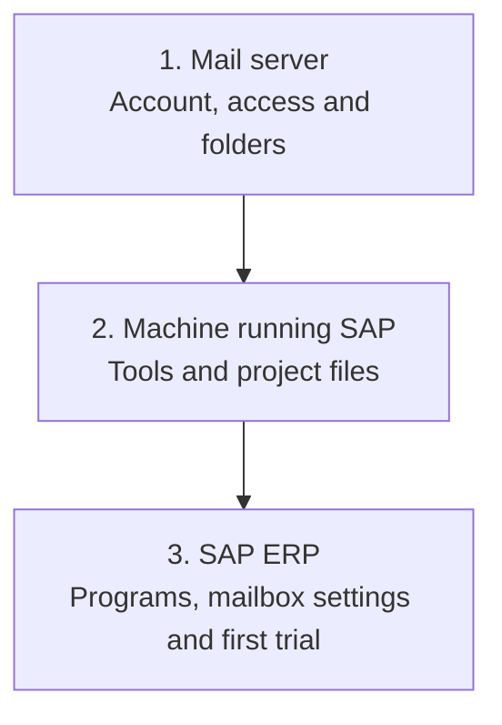
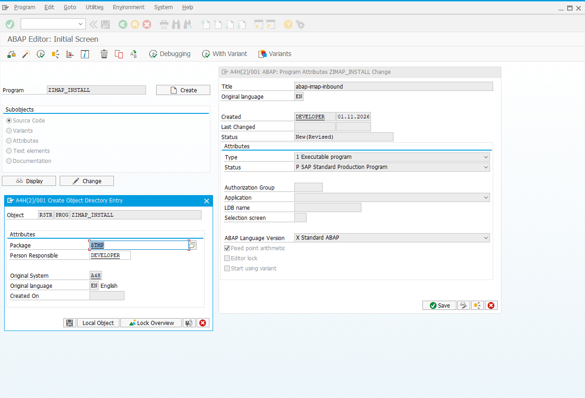
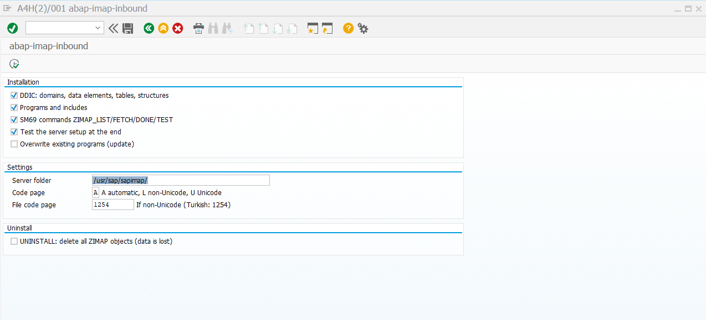
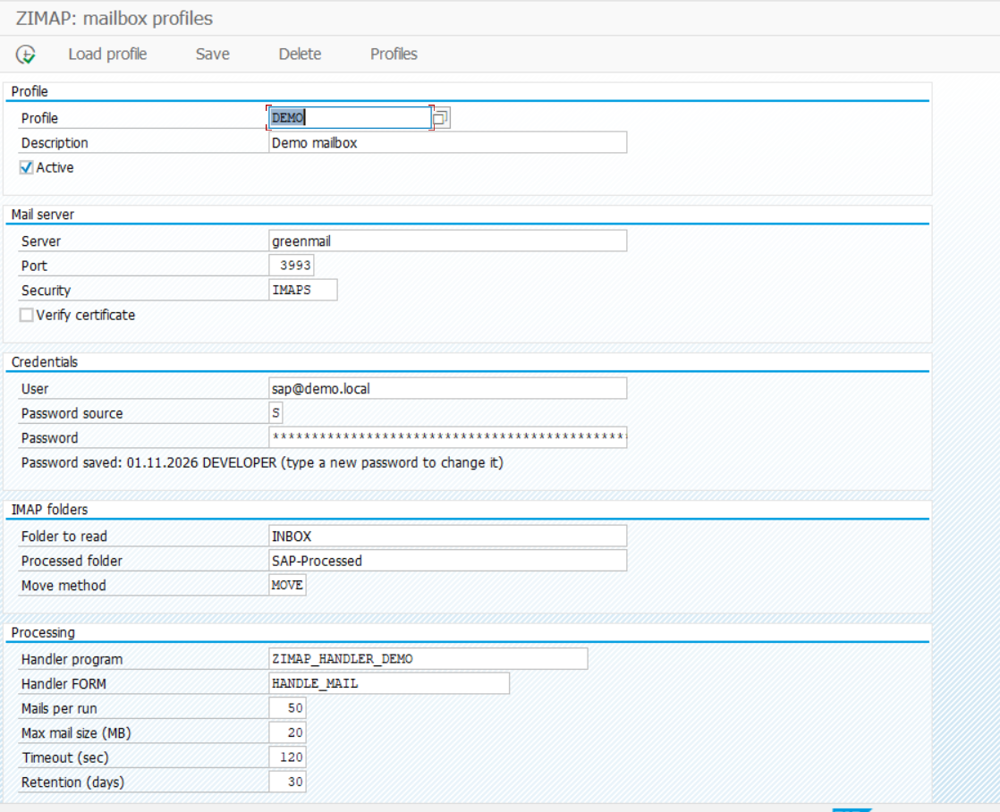
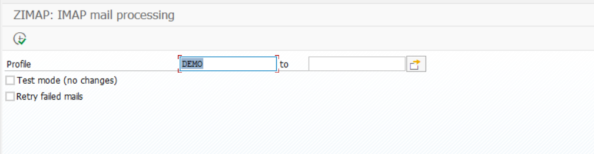
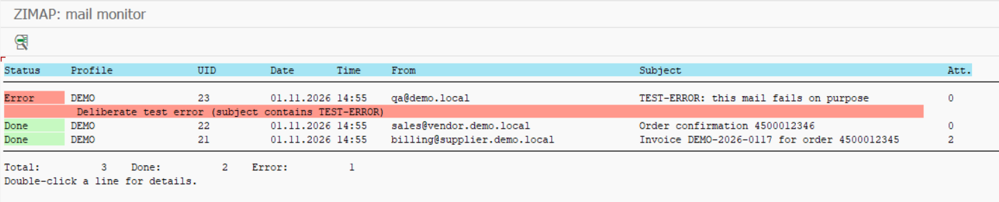

# Walkthrough: prepare three parts and see your first email in SAP

> **English** | [Türkçe](tr/WALKTHROUGH.md) · [Overview](../README.md) · [Technical details](TECHNICAL-REFERENCE.md)

We will connect a mail account, the machine running SAP and the programs inside SAP ERP. At the end, we will use the supplied example to view a test email and attachment in SAP.

## Start with the whole picture

Installation needs **three prepared parts**:

This does not mean installing three separate machines. **Part 2** is Windows/Linux preparation on the SAP host; **part 3** is the work done through SAP GUI. The mail service may already exist.

First prepare the connection details in part 1, then make the connection available from the SAP machine in part 2. In part 3, install the SAP programs and enter those settings. Finally, check everything with one test email.

## Before you start

We assume you can create, activate and run programs in SE38 and have permission to do so. You perform the SAP steps yourself. Prepare the mailbox and server yourself if you administer them; otherwise ask their administrators for the items listed in those sections. Here, Basis means whoever takes responsibility for server administration.

For authorized RDP/SSH access and file transfer, use the [self-managed setup guide](SELF-MANAGED-SETUP.md).

**Use a test SAP system and test mailbox.** Normal processing may mark mail as read and move it. The example does not create invoices.

This guide covers the 1.1.0 sources; actual SAP acceptance tests for this version are still pending. Images show the earlier 1.0 demonstration and fields may differ. [Test status](TECHNICAL-REFERENCE.md#what-has-been-verified).

### Download the files

Open the [GitHub repository](https://github.com/Cheditte/abap-imap-inbound), choose **Code → Download ZIP** and unpack the entire archive. Git is not required.

Keep the folder structure and use files from the same version. You will use the root-level `ZIMAP_INSTALL.abap` file for the SAP steps. If someone else prepares the server, share the same package with them; they need both the `server` and `script` folders.

## 1. Prepare the mail server

**Goal:** Choose the account SAP will read, its sign-in method and folders. You do not need to install a new mail server; use a suitable account on an existing service.

Obtain the server name, port, security type and login details from your email administrator. **An email address and correct password may not be enough.** The account must allow another program to read it through **IMAP access**. Have the email team confirm that the account can connect with this project. [Detailed connection requirements](TECHNICAL-REFERENCE.md#before-you-start-is-your-mailbox-suitable).

If you do not have an email team, obtain these settings from your account's provider panel or provider support. Being able to open your mailbox does not mean you can change mail-server settings. [Preparing the account yourself](SELF-MANAGED-SETUP.md).

The default source is the **inbox (`INBOX`)**. You can select a different folder if you only want messages from there. For processed messages, you can use an existing folder in the same email account. The initial `SAP-Processed` value is an example; you do not have to create a new folder with that name. Confirm the actual folder names with the email team.

**Output from this part:** Actual IMAP hostname, port, security type, login details, source folder and a different destination folder. Keep passwords out of tickets and screenshots.

## 2. Prepare the machine running SAP

**What are we doing?** Preparing the tools and project files that retrieve email on the Windows or Linux machine running SAP. This is usually done once at initial setup.

| Component to prepare | What is it for? |
|---|---|
| **PowerShell** | Runs the project's mail retrieval commands. Windows needs 5.1 or later; Linux needs 7. |
| **curl** | Connects to the mail server. It must support encrypted IMAP connections. |
| **The project's server files** | Prepare messages and attachments as files SAP can read. They are included in the download. |
| **A protected working folder** | Holds email, attachments and connection settings on the server. Basis chooses its path and access permissions. |

Suitable PowerShell and curl installations do not need to be installed again. Basis installs anything missing using your organization's process, then runs the server setup included in the project. The Windows and Linux commands are in [server setup for Basis](TECHNICAL-REFERENCE.md#server-setup-commands-and-checks).

Basis also checks that **the machine running SAP can connect to the mail server**. Accessing the account from your own computer does not replace this check.

Without a Basis team, you can perform this step on your own test server if you have administration permissions. The [separate guide](SELF-MANAGED-SETUP.md) explains how to connect, transfer the files and choose the terminal in which to run the commands.

**When can you continue?** If you prepared the server, check that the test passes; if another team prepared it, obtain their confirmation. Record the SAP server to use and the **full path** of the working folder. We will use that same server and folder in the following steps.

## 3. Install the programs in SAP ERP

The mailbox settings and host preparation are ready. Now use SAP GUI to install the programs and enter the information from those two parts. There are three steps here: create the installer, run it and save a mailbox profile.

### 3.1. Create the installer program

**What are we doing?** Preparing a program that creates the SAP programs and tables the project needs. Perform this step with your own SAP development permissions.

Create the following program in SE38.

1. Enter **`ZIMAP_INSTALL`** as the program name and choose **Create**.
2. Enter a description and select **Executable program** as the type.
3. When saving, use a customer package you have created or one assigned to the project, for example `ZIMAP`. **Local Object** can be used for a temporary trial only.
4. Open the downloaded [ZIMAP_INSTALL.abap](../ZIMAP_INSTALL.abap) file and paste its **entire contents** into the SAP editor.
5. Save, check the syntax and choose **Activate**.

**When can you continue?** Once the program activates without errors. Resolve syntax or activation errors before moving on. Keep the program name as shown.

### 3.2. Run the installer

**What are we doing?** The installer will create the SAP screens, tables and definitions needed to connect SAP to the server tools.

Open **`ZIMAP_INSTALL`** in SE38 and choose **Execute (F8)**.

- For a first installation, leave **DDIC objects**, **Programs**, **SM69 commands** and **Server check** selected. These cover tables, programs, server commands and the final check.
- Enter the **full folder path supplied by Basis** in **Server folder**. Do not assume the example path is right for your system.
- Leave **Uninstall** cleared. Review the other options.
- Press **F8** and read the results.

**When can you continue?** Once the selected installation steps and final server check succeed. Review the failed step; involve the responsible team for server access or permission problems outside your control.

**For maintained use:** The installer currently creates its objects in the local area `$TMP`. Saving the installer itself in a package does not change this. Assign the objects to your customer package and plan transport to test and production systems; coordinate transport settings with their administrators where needed. [Package and transport details](TECHNICAL-REFERENCE.md#2b-before-production-package-and-transport).

### 3.3. Set up a mailbox profile

**What are we doing?** Telling SAP which email account to connect to and which folder to read. These settings are saved together as a **profile**.

Open **`ZIMAP_CONFIG`** in SE38 and run it with **F8**. Use a SAP session connected to the server Basis prepared; ask Basis to check if you are unsure.

| Field | What should you enter or select? |
|---|---|
| Profile | A name for your settings, for example `INVOICE`. You may choose another name; use the same name in later steps. |
| Active | Selected, to allow this profile to be processed. |
| Server, port and security | Actual values from your email team. Do not enter your email address in the server field. Keep certificate verification enabled. |
| Username and password | Login details confirmed by the email team. Password source `S` means entering the password in SAP; `O` means Basis saves it on the server. Agree the method with Basis. |
| Folder to read | The default `INBOX` reads the inbox. For another folder, enter its actual name/path. |
| Processed folder | Actual name/path of the folder you select in the same email account for successful messages; choose a different folder from the source. The name `SAP-Processed` is not required. |
| Move method | Select `MOVE` for the first trial. |
| Handler program | Leave **`ZIMAP_HANDLER_DEMO`** selected. This is the supplied example program that runs for each message. |

For the trial, review the remaining message count, size and timeout limits with Basis and keep the starting values where appropriate. Full field descriptions and server password commands are in the [technical reference](TECHNICAL-REFERENCE.md#profile-fields-and-server-managed-passwords).

Press **F8** to save and test the connection. Keep passwords out of screenshots and support tickets.

**When can you continue?** Once the connection test succeeds for the intended mailbox. Saved settings alone do not prove the connection works.

## 4. Test the three parts together

Check the complete path: a message must be retrieved from the source folder, become visible in SAP and move to your destination folder.

### 4.1. Process mail

**What are we doing?** First checking that the mailbox can be read, then retrieving a test message.

Send an email with a small PDF or text attachment to the test mailbox. If you selected a source folder other than the inbox, place the message in that folder.

1. Open **`ZIMAP_INBOUND`** in SE38 and run it.
2. Enter the **profile name** saved in the previous step.
3. Select **List only (no downloads/changes)** and press **F8**. This lists eligible message numbers; it does not yet retrieve content or attachments, or move messages.
4. If listing succeeds, go back, **clear List only** and run it again. This time the email and attachments are retrieved, the supplied example runs and successful mail is moved to your processed folder.

**When can you continue?** Once the run finishes. Next, we will check the result in SAP and in the mailbox.

### 4.2. Monitor mails and attachments

**What are we doing?** Checking the result and confirming that the attachment can be accessed from SAP.

1. Open **`ZIMAP_MONITOR`** in SE38 and run it.
2. Select your profile and a date range covering the test, then press **F8**.
3. Open your test message's record and inspect its text and attachments.
4. Open the email account too. Successful mail should be in the processed folder you selected.

| Status | Meaning |
|---|---|
| `S` | Processing and moving the mail are complete. |
| `E` | An error occurred; read the explanation in the record. |
| `R` | A failed message has been marked for another attempt. |
| `H` | The SAP business step is complete, but moving the mail is pending. |

PDFs and common images can open in a suitable application. Download other attachments, such as Excel files, and inspect them with an application on your computer.

**A successful first trial means:** you see status `S`, can access the attachment and can find the message in the processed folder. The supplied example does not also create an invoice or purchase order.

#### If a step fails

- **Sign-in or folder error:** Ask the email team to check connection details, IMAP access and the selected folder names.
- **Connection, certificate or SAP permission error:** Ask Basis for help. Keep certificate verification enabled.
- **The example or your business program fails:** Review the error and the relevant program. The supplied example deliberately fails for subjects containing `TEST-ERROR`.

Share the error text and the step you reached, without passwords. Authorized users can mark failed messages for another attempt. Do not delete log records or server files to force reprocessing. [Retry details](TECHNICAL-REFERENCE.md#retention-and-retry-details).

## 5. Schedule regular processing

**What are we doing?** After the trial succeeds, having the mailbox checked automatically at agreed intervals.

If you have SM36 permission, create a **background job** for `ZIMAP_INBOUND`; otherwise ask Basis to schedule it. It must use the correct profile, have list-only cleared and run on the **same SAP machine** prepared for this installation. Test with the user that will run the job, or have the responsible team do so.

Agree the business action with the process owner and implement it. For example, linking an attachment to a purchase order is added through the connection point in the [developer guide](TECHNICAL-GUIDE.md). Before production use, validate business rules, permissions and package/transport steps in your test system.

**If you are updating an existing installation,** follow the [upgrade procedure](TECHNICAL-REFERENCE.md#8-update-an-existing-installation) rather than directly repeating the first-install steps. Server commands and detailed checks are in the [technical reference](TECHNICAL-REFERENCE.md).
