# From setup to your first email and scheduled use

> **English** | [Türkçe](tr/WALKTHROUGH.md) · [Overview](../README.md) · [Field guide](SCREEN-GUIDE.md)

Prepare the mailbox, SAP host and SAP programs first. Then open a test email in SAP and, if needed, schedule the same process in the background.

## Choose your goal first

**List only** shows message identifiers without downloading mail or attachments. **Normal processing** downloads content, runs the selected ABAP handler, and moves successful mail to the destination folder.

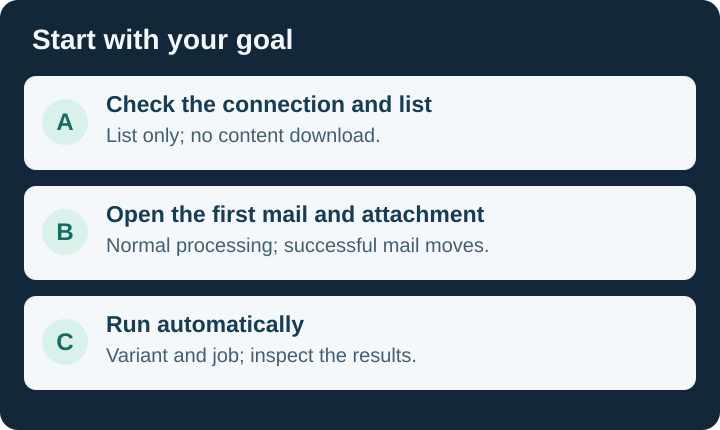

| Goal | Route | How do you recognize completion? |
|---|---|---|
| Install for the first time | [Three preparations](#prepare), then [SAP setup](#install) | SAP objects ready; [mailbox profile](#33-set-up-a-mailbox-profile) connects successfully. |
| Check connectivity | [Path A — List only](#list-only) | Message identifiers or an empty-mailbox result; no content download. |
| Open mail and an attachment | [Path B — First email](#first-mail) | Monitor content and attachment available; successful mail in the destination. |
| Add my business action | [Developer guide](TECHNICAL-GUIDE.md) | Your validated ABAP action replaces the demonstration. |
| Run automatically | [Path C — Variant and job](#daily-use) | Job runs on the selected host; log and spool reviewed. |

This guide describes `v0.9.3`. [Validation record](../VALIDATION.md).

The screenshots show the real A4H/001 installation and GreenMail demonstration; the installer result shows v0.9.3.

## Three preparations before you start

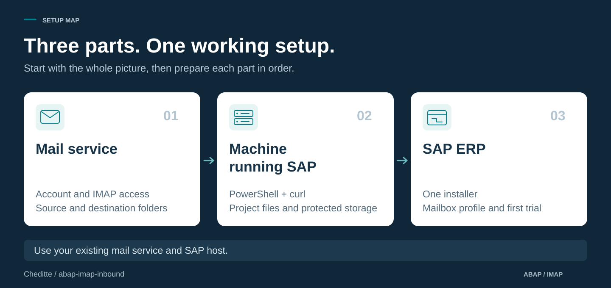

We assume you can create and activate programs in SE38. **Use a test SAP system and a dedicated test mailbox.** Prepare the host and mailbox yourself if you administer them; otherwise pass the listed requirements to their administrators.

### Download the files once

In the [repository](https://github.com/Cheditte/abap-imap-inbound), choose **Code → Download ZIP** and extract the whole archive. Git and abapGit are optional. Keep `server`, `script` and `ZCHE_IMAP_INSTALL.abap` from the same version. Give the same archive to whoever prepares the host.

## 1. Prepare the mail server

**Goal:** choose the account SAP will read and two mail folders.

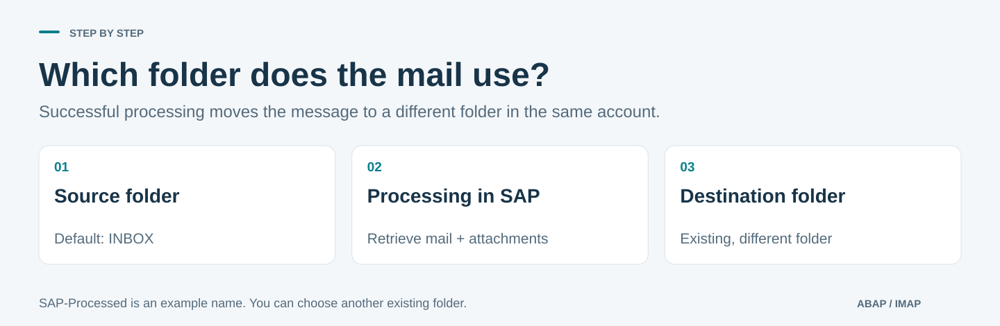

1. Obtain the **actual IMAP hostname, port and security type** from the provider or administrator. Do not enter your email address as the hostname.
2. Confirm that the account permits IMAP and password/app-password sign-in. A correct password alone may be insufficient. This version does not support Microsoft 365 / Exchange Online or OAuth-only accounts.
3. Select the source folder. `INBOX` is the default inbox; use the actual IMAP name for another folder.
4. Choose **a different existing destination folder in the same account** for successful mail. `SAP-Processed` is only an example; you do not have to create that name.

**Continue when:** connection details, an approved sign-in method and both actual folder names are ready. Keep passwords out of support tickets and screenshots. [Detailed requirements](TECHNICAL-REFERENCE.md#before-you-start-is-your-mailbox-suitable).

## 2. Prepare the machine running SAP

**Goal:** prepare mail retrieval tools on the Windows/Linux machine running SAP. This can be different from your SAP GUI computer.

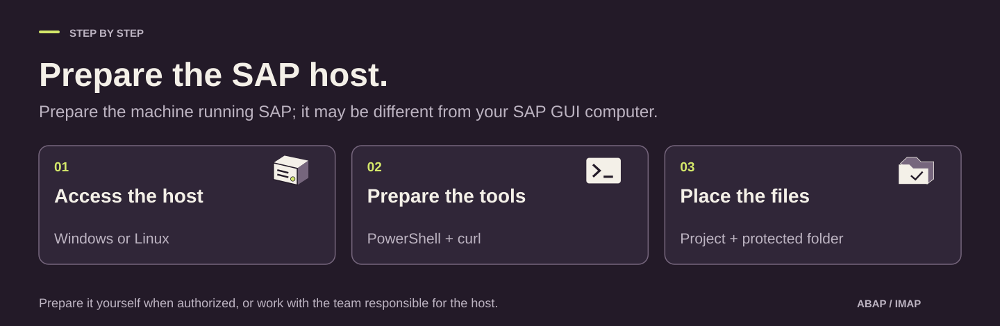

| Preparation | Purpose | Expected output |
|---|---|---|
| PowerShell | Runs the project's host commands. | Windows PowerShell 5.1; Linux PowerShell 7.4+. |
| curl | Connects to the mail server using encrypted IMAP. | Version 7.66.0+ with `imaps` support. |
| Project files and folder | Holds mail, attachments and connection files. | Matching script versions and protected directories. |
| Network and certificates | Allows the SAP host to reach the mail service. | Actual mail endpoint/port reachable; certificate trust prepared. |

If you hold administrator access, follow the [RDP/SSH and file transfer guide](SELF-MANAGED-SETUP.md). Otherwise share the table with the responsible team. Run the [Windows](TECHNICAL-REFERENCE.md#windows) or [Linux setup commands](TECHNICAL-REFERENCE.md#linux) on the SAP machine.

**Continue when:** the host check reports `PROTOCOL 2`, `VERSION 0.9.3` and the correct folder, ending in `OK`. Record the **SAP application server and full working-folder path**. Use that same host in subsequent steps.

## 3. Install the programs in SAP ERP

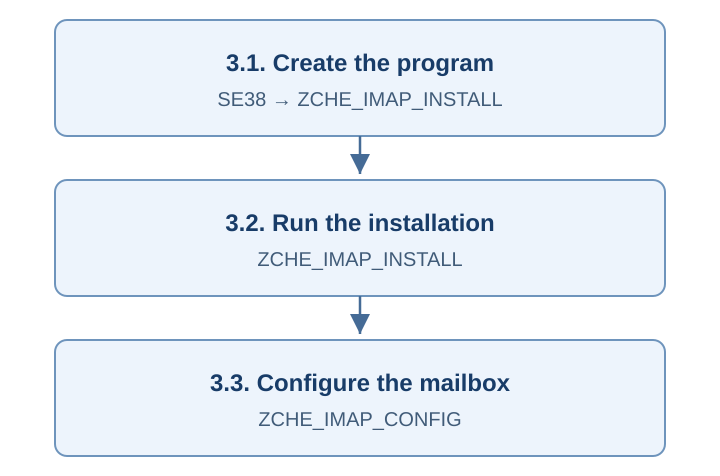

### 3.1. Create the installer program

1. In **SE38**, enter `ZCHE_IMAP_INSTALL` and choose **Create**.
2. Enter a description; choose **Executable program** in **Type**, then save.
3. Use your customer package, for example a package you created as `ZCHE_IMAP`; `$TMP` is for a temporary local trial.
4. Replace the starter code with the **entire source** from [the installer file](../ZCHE_IMAP_INSTALL.abap), rather than a GitHub page saved as HTML.
5. Save, check syntax and activate with **Ctrl+F3**.

**Continue when:** the program is active without syntax errors.

### 3.2. Run the installer

Execute `ZCHE_IMAP_INSTALL` with **F8** and set these options:

| Option | First installation |
|---|---|
| DDIC, Programs, SM69 commands, Server check | Selected; creates the SAP objects and checks the host setup. |
| Server folder | The **actual full path** prepared in part 2, for example `/usr/sap/sapimap/` in this demonstration. |
| Code page | Automatic; see the [technical settings](TECHNICAL-REFERENCE.md#sap-installation-options-and-checks) for older non-Unicode systems. |
| Overwrite existing programs | Cleared for a new installation; follow the [upgrade route](#upgrade) for updates. |
| Uninstall | **Cleared.** |

Press F8 again and read the result list, including the final host check; continue when it ends with `OK` and `Installation complete.`

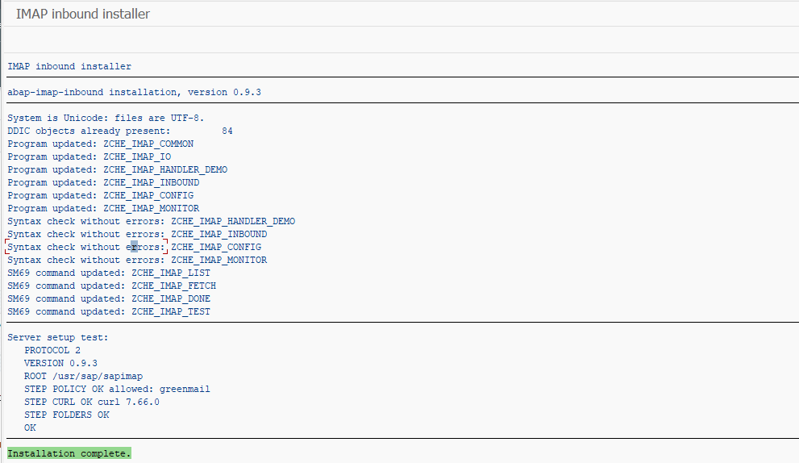

The v0.9.3 installation completed after the program syntax checks and server setup check passed.

Generated objects go into `$TMP`; putting the installer itself in a package does not change this. For maintained use, reassign the objects to your customer package and prepare transport. [Package and transport](TECHNICAL-REFERENCE.md#2b-before-production-package-and-transport).

The programs use standard authorizations (`S_TABU_DIS`, `S_LOG_COM`, `S_DATASET`); a developer user usually has them. For job users and optional per-profile access (`ZCHE_IMAP`), see [SECURITY](../SECURITY.md).

### 3.3. Set up a mailbox profile

A **profile** saves your mailbox connection and processing settings under one name. Open **SE38 → `ZCHE_IMAP_CONFIG` → F8**.

1. Choose a profile name, for example `DEMO`, and select **Active**.
2. Enter your **actual** IMAP server, port, security type and login.
3. Choose the password source: the default **`O`** means the password is managed on the SAP host. To enter it in SAP, **type `S` and press Enter**; the password field then becomes available. Enter the password and keep it out of screenshots.
4. Choose the source and destination folders, then keep the demo handler for your first trial.

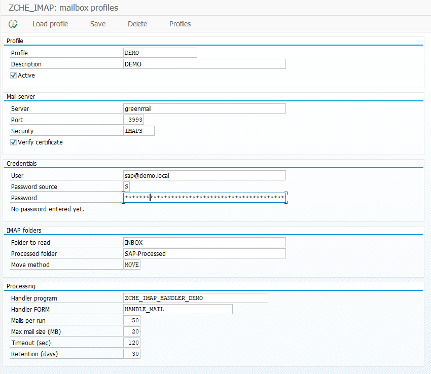

The DEMO profile shows the GreenMail test values and a masked password entered with source `S`.

| Field | What to enter |
|---|---|
| Server / Port / Security | Your mailbox's actual IMAP endpoint; the local GreenMail example is `greenmail` / `3993` / `IMAPS`. |
| Verify certificate | Keep selected for real mailboxes; the isolated GreenMail trial used it **cleared** for its self-signed test certificate. |
| User | The actual IMAP login; `sap@demo.local` belongs only to this local demonstration. |
| Password source | Default `O`: [prepare the host credential](TECHNICAL-REFERENCE.md#profile-fields-and-server-managed-passwords) using the actual `SID_CLIENT_PROFILE` key; `S` + Enter: enter the password in SAP. |
| Folder to read | `INBOX`, or your chosen existing source folder. |
| Processed folder | A different existing folder in the same account; `SAP-Processed` is the example, not a required name. |
| Move method | `MOVE`; the mail server must support UID MOVE. |
| Handler program / FORM | `ZCHE_IMAP_HANDLER_DEMO` / `HANDLE_MAIL` for the first trial. |

The profile screenshot shows verification selected before the first attempt; the successful GreenMail connection below used the test-only exception described above. For a real mailbox, keep verification enabled and configure the trusted certificate chain on the SAP host.

5. Press **F8 inside the profile screen** to save and test connectivity; saved passwords are not displayed again.
6. Check `LOGIN`, `INBOX` and `PROCESSED`; `INBOX: 0 mails` means the mailbox is empty, rather than a connection failure.

[All profile fields explained](SCREEN-GUIDE.md#profile).

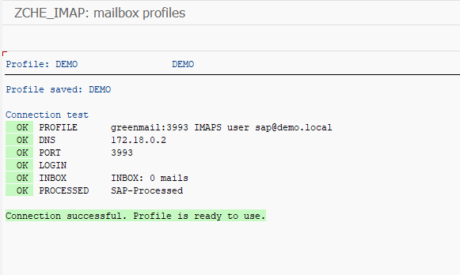

The connection test reached GreenMail, signed in and checked both folders successfully.

## Path A — Check connectivity and list messages

1. Open **SE38 → `ZCHE_IMAP_INBOUND` → F8** to reach the selection screen.
2. Enter **only your dedicated test profile**. An empty profile selection includes all active profiles.
3. **Select List only (no downloads/changes).**
4. Execute with F8. A `UID` is the mail server's message identifier, not a business document number.

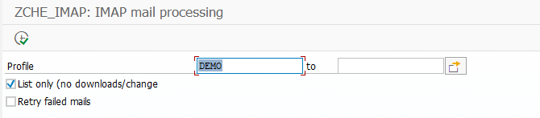

Select **List only** for this route; this image shows the selection screen before execution.

**Success:** eligible message identifiers or an empty-mailbox result. This path **does not download bodies/attachments, call the handler or move mail**. [Selection fields](SCREEN-GUIDE.md#processing).

## Path B — Open the first email and attachment in SAP

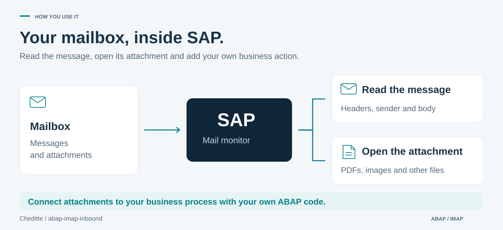

### B1. Process a dedicated test message

1. Send a small PDF/text attachment to the test account. If using another source folder, put the message there.
2. Keep the supplied demo handler in the same test profile.
3. Return to INBOUND, **clear List only** and execute with F8.

**Normal mail processing starts now.** Mail and attachments are retrieved; the example attempts to read attachments. Successful mail moves to the destination and may be marked as read. The example does not create an invoice or purchase order.

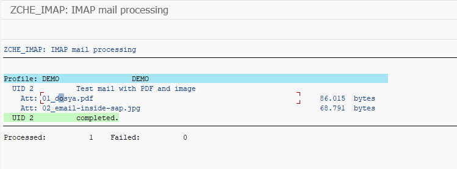

UID `2` completed with two attachments, and the result reports `Processed: 1`, `Failed: 0`.

### B2. Verify in the monitor

1. Open **SE38 → `ZCHE_IMAP_MONITOR` → F8**.
2. Enter your profile and a date range covering the SAP processing run, then execute with F8.
3. Look for **Done** (`S`); the example has two processed messages and no errors.

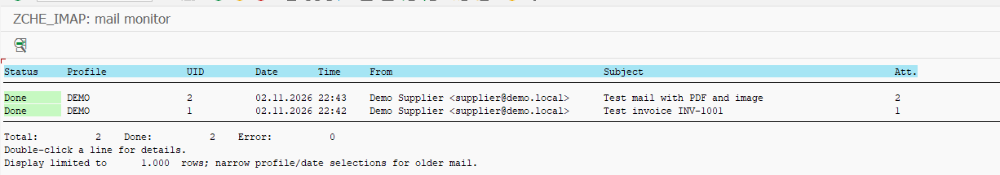

Both test messages appear as Done in the DEMO monitor list.

4. Double-click the message to view its headers, body and attachment links.

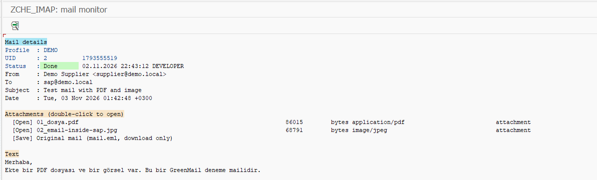

The detail screen displays the mail body and the `01_dosya.pdf` and `02_email-inside-sap.jpg` attachment links.

5. Double-click an attachment's **Open** line; PDF, text and supported images open in an appropriate viewer, while other file types download only. **Original mail** downloads the EML without opening it automatically.
6. In the mailbox, confirm that the successful message moved to your chosen destination folder.

| Status | Meaning and next step |
|---|---|
| `S` — Done | Processing and movement complete; verify attachment and destination. |
| `E` — Error | Read the explanation and correct the cause. Ordinary runs skip earlier failures. |
| `H` — To move | Business result committed; movement pending. A normal run attempts movement recovery only. |
| `R` — Retry | An authorized user requested reprocessing; a normal run may try again. |

**Success:** an `S` record, an accessible attachment and the message in the destination verified together. Do not delete logs/files to force replay. [Errors and retry](SCREEN-GUIDE.md#errors).

### B3. Add your ABAP action

Follow the [developer guide](TECHNICAL-GUIDE.md) to copy the handler to your customer program. Preserve the allowed name prefix and transaction contract. Use your business key to prevent a document being created twice. The processor owns the commit.

## Path C — Run automatically at agreed intervals

**Flow:** selections → variant → SM36 → SM37 log/spool. A variant stores settings; the job runs the program with those settings.

### C1. Prepare a list-only variant first

In INBOUND, enter your profile, **select List only**, and leave retry cleared. Save a variant under an unused name such as `IMAP_LIST_DEMO`; the name is only an example. Reload it to check the stored selections.

### C2. Define the job in SM36

1. Open **SM36** and enter an unused job name, for example `ZCHE_IMAP_LIST_DEMO`.

2. Use **Job Class C** unless your organization specifies another class.
3. Set **Target** to the installation's application server. In a multi-server system, do not leave host selection to chance.
4. Choose **Step → ABAP program**; enter `ZCHE_IMAP_INBOUND` and your list-only variant. Check the execution user and save the step.

### C3. Set the start condition and inspect the result

1. For the first check, choose **Start condition → Immediate** with **Periodic Job cleared**. Save the condition and the main job.
2. In **SM37**, search by your job name, user and execution time. Widen status filters and refresh if needed.
3. Read **Job log** and **Spool**. **Finished does not mean mail was moved:** list-only jobs do not download content. Review counts and error details.

After checking the real job user and selected host, prepare **a separate variant and job** for Path B's normal processing. Clear List only only in that variant. Agree the interval with operations; use **Date/Time + Periodic Job + Period values** in SM36. Confirm the SAP/job timezone. Monitor initial runs through the monitor, log/spool and mailbox together.

## If you already have an installation

Do not repeat first-install instructions without review. Stop scheduled work and follow the [upgrade procedure](TECHNICAL-REFERENCE.md#8-update-an-existing-installation).

For `0.9.x → 0.9.3`, replace and activate the SAP installer source with the current file and deploy both matching host modules. After backup/review, select **Programs + Overwrite existing programs (update) + Server check**; assess required SM69/DDIC steps for your installation. Overwrite can replace local source changes. Do not resume jobs before host and profile checks succeed.

Old `ZIMAP_` and new `ZCHE_IMAP_` jobs must not process the same mailbox together. Old history is not migrated automatically.

## When you need help

[Field guide](SCREEN-GUIDE.md) explains screen choices. [Technical reference](TECHNICAL-REFERENCE.md) covers connectivity, host setup and transport. [SECURITY](../SECURITY.md) covers roles and credentials. Share the failed step and error text, without passwords or real mail content.
