# Kurulumdan ilk maile ve otomatik kullanıma

> [English](../WALKTHROUGH.md) | **Türkçe** · [Proje özeti](../../README.tr.md) · [Alan rehberi](SCREEN-GUIDE.md)

Bu rehberde önce posta hesabını, SAP sunucusunu ve SAP programlarını hazırlayacaksınız. Ardından bir deneme e-postasını SAP içinde açacak; isterseniz aynı işlemi arka planda çalışacak şekilde planlayacaksınız.

## Önce hedefinizi seçin

**Yalnız listeleme**, ileti numaralarını gösterir; maili veya eki indirmez. **Normal işleme**, içeriği indirir, seçtiğiniz ABAP örneğini çalıştırır ve başarılı maili hedef klasöre taşır.

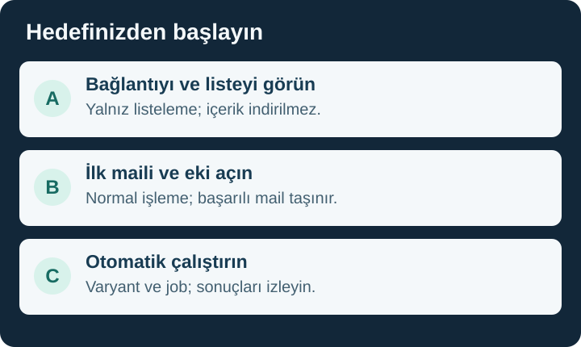

| Hedef | İzlenecek yol | Bittiğini nasıl anlarsınız? |
|---|---|---|
| İlk kez kurmak | [Üç hazırlık](#hazirlik), ardından [SAP kurulumu](#kurulum) | Programlar ve yetkiler hazır; profil bağlantısı başarılı. |
| Bağlantıyı kontrol etmek | [Yol A — Listeleme](#listeleme) | İleti numaraları veya boş kutu sonucu görülür; içerik indirilmez. |
| Mail ve ekini açmak | [Yol B — İlk mail](#ilk-mail) | Monitörde mail/ek açılır; başarılı mail hedef klasördedir. |
| Kendi iş adımımı eklemek | [Geliştirici rehberi](TECHNICAL-GUIDE.md) | Hazır örnek yerine kendi doğrulanmış ABAP işleminiz kullanılır. |
| Otomatik çalıştırmak | [Yol C — Varyant ve job](#otomatik) | Doğru sunucuda çalışan işin log ve spool'u incelenir. |

Rehber `v0.9.3` sürümünü anlatır. [Doğrulama kaydı](../../VALIDATION.md).

SAP ekran örneklerinde menüler İngilizcedir; adımlarda Türkçe karşılıkları da verilir. Görseller SE38 ve SM36 hazırlık ekranlarını gösterir. [Görsellerin kapsamı](../screenshots/README.md).

## Başlamadan önce üç hazırlık

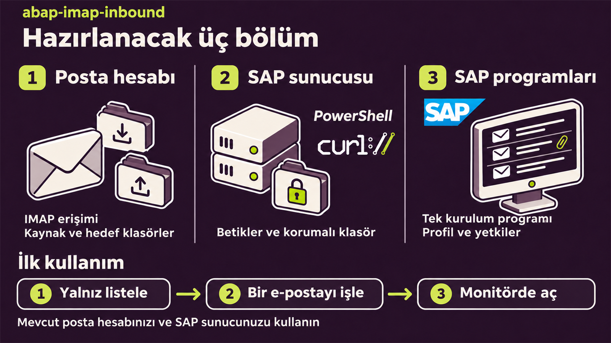

SE38'de program oluşturup etkinleştirebilen bir SAP geliştiricisi olduğunuz varsayılır. **Deneme SAP sistemi ve ayrı bir deneme posta kutusuyla başlayın.** Sunucu ve posta yönetimi sizdeyse aşağıdaki hazırlıkları da yapabilirsiniz; değilse ilgili yöneticiye belirtilen bilgileri iletin.

### Dosyaları bir kez indirin

[Depoda](https://github.com/Cheditte/abap-imap-inbound) **Code → Download ZIP** seçip arşivin tamamını açın. Git veya abapGit zorunlu değildir. `server`, `script` ve `ZCHE_IMAP_INSTALL.abap` aynı sürümden olmalı. Sunucuyu başka biri hazırlayacaksa aynı arşivi ona verin.

## 1. Posta sunucusunu hazırlayın

**Amaç:** SAP'nin okuyacağı hesabı ve iki posta klasörünü belirlemek.

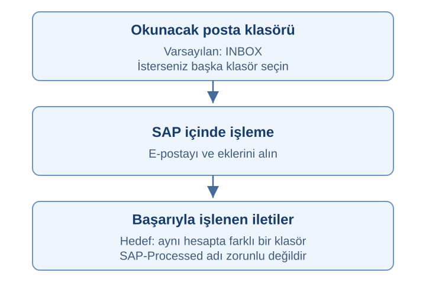

1. Posta sağlayıcısından veya yöneticiden **gerçek IMAP sunucu adı, port ve bağlantı türünü** alın. Sunucu alanına kendi e-posta adresinizi yazmayın.
2. Hesabın IMAP erişimine ve parola/uygulama şifresiyle girişe izin verdiğini doğrulatın. Doğru parola tek başına yeterli olmayabilir. Bu sürüm Microsoft 365 / Exchange Online veya yalnız OAuth kabul eden hesaplarla çalışmaz.
3. Okuma klasörünü seçin. Varsayılan `INBOX`, Gelen Kutusu'dur; başka klasör istiyorsanız onun gerçek IMAP adını kullanın.
4. Başarılı mailler için **aynı hesapta farklı, mevcut bir hedef klasör** seçin. `SAP-Processed` yalnız örnek addır; bu adla yeni klasör oluşturmanız gerekmez.

**Devam koşulu:** Bağlantı bilgileri, onaylı giriş yöntemi ve iki gerçek klasör adı elinizde. Parolayı destek kaydına veya ekran görüntüsüne koymayın. [Ayrıntılı posta koşulları](TECHNICAL-REFERENCE.md#başlamadan-önce-posta-kutunuz-uygun-mu).

## 2. SAP'nin kurulu olduğu makineyi hazırlayın

**Amaç:** Maili getiren araçları SAP'nin çalıştığı Windows/Linux makinesine hazırlamak. SAP GUI'yi açtığınız bilgisayar aynı makine olmayabilir.

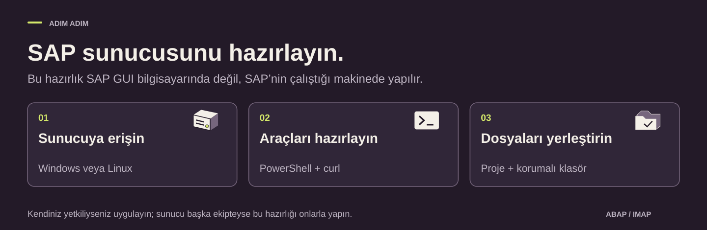

| Hazırlık | Ne işe yarar? | Beklenen çıktı |
|---|---|---|
| PowerShell | Projenin sunucu komutlarını çalıştırır. | Windows'ta 5.1; Linux'ta 7.4+ hazır. |
| curl | Posta sunucusuna şifreli IMAP bağlantısı kurar. | Sürüm 7.66.0+ ve `imaps` desteği. |
| Proje dosyaları ve klasör | Mail, ek ve bağlantı dosyalarını tutar. | İki betik aynı sürümde; klasör ve dosya izinleri hazırlanmış. |
| Ağ ve sertifika | SAP sunucusunun posta hizmetine erişmesini sağlar. | Gerçek posta adresine/portuna erişim; sertifika güveni hazır. |

Yönetim yetkiniz varsa [RDP/SSH ve dosya aktarımı rehberini](SELF-MANAGED-SETUP.md) izleyin. Başka ekip hazırlayacaksa tabloyu onlara iletin. [Windows](TECHNICAL-REFERENCE.md#windows) veya [Linux kurulum komutlarını](TECHNICAL-REFERENCE.md#linux) SAP makinesinde çalıştırın.

**Devam koşulu:** Sunucu kontrolü `PROTOCOL 2`, `VERSION 0.9.3` ve doğru klasörü gösterip `OK` ile bitmeli. Kullanılacak **SAP uygulama sunucusunu ve tam çalışma klasörü yolunu** not edin. Sonraki adımlarda aynı sunucuyu kullanın.

## 3. SAP ERP içindeki kurulumu yapın

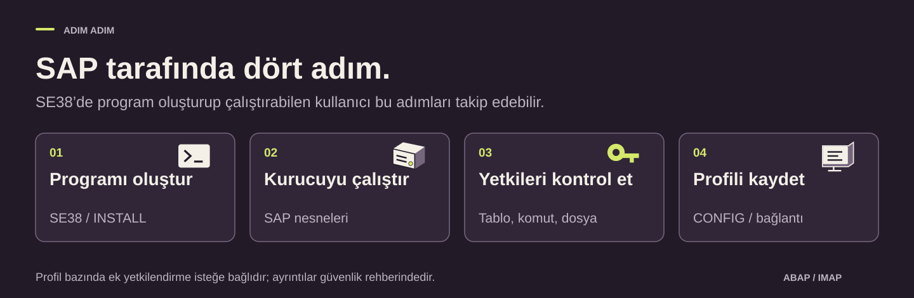

### 3.1. Kurulum programını oluşturun

1. **SE38**'de program adına `ZCHE_IMAP_INSTALL` yazıp **Create / Oluştur** seçin.

   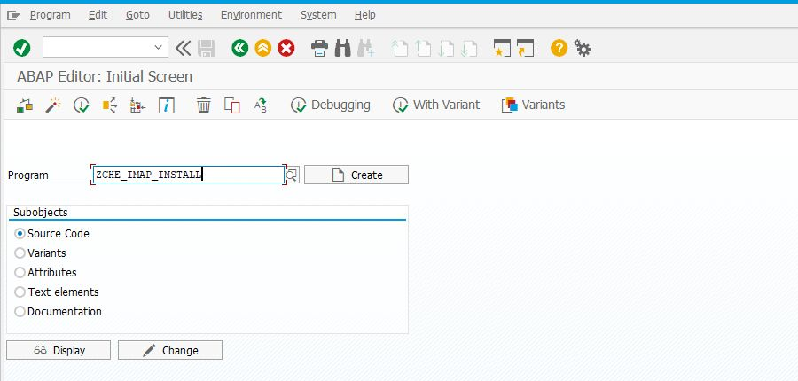

   **Bu ekranda:** program adını yazdıktan sonra **Create** ile özellikler penceresine geçin.

2. Açıklama girin; **Type / Tür** alanında **Executable program / Çalıştırılabilir program** seçin.

   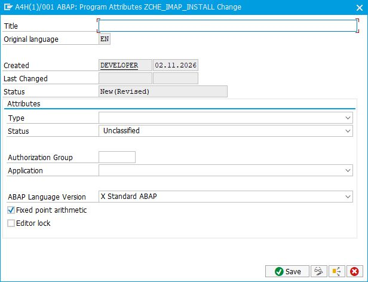

   **Bu ekranda:** **Title** alanına örneğin “IMAP kurulumu” yazın; boş görünen **Type** alanından **Executable program** seçip kaydedin. Görsel, alanlar doldurulmadan önceki pencereyi gösterir.

3. Kendi müşteri paketinizi kullanın; örneğin önceden oluşturduğunuz `ZCHE_IMAP`. `$TMP` yalnız geçici yerel deneme içindir.
4. [Installer dosyasının](../../ZCHE_IMAP_INSTALL.abap) **tam kaynak kodunu** başlangıç kodunun yerine koyun. GitHub sayfasını HTML olarak kaydedip yüklemeyin.
5. Kaydedin, sözdizimini kontrol edin ve **Ctrl+F3** ile etkinleştirin.

**Devam koşulu:** program etkin ve sözdizimi hatası yok.

### 3.2. Kurulumu çalıştırın

`ZCHE_IMAP_INSTALL` içinde **F8**:

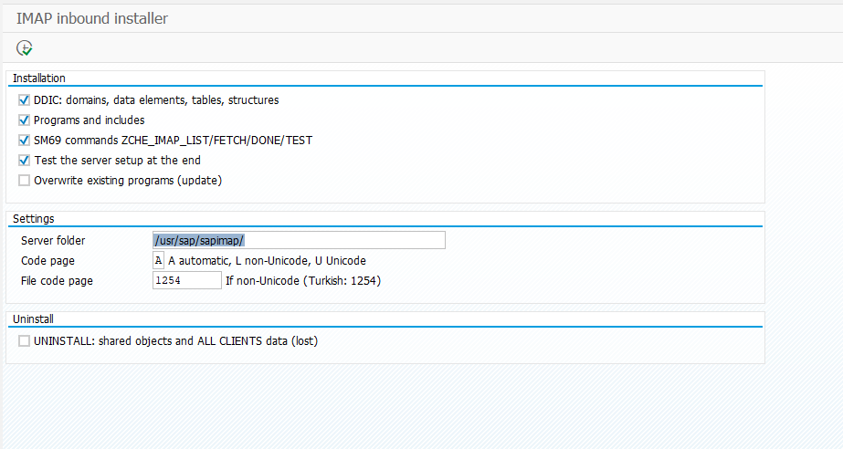

Görselde bu deneme için hazırlanan `/usr/sap/sapimap/` klasörü kullanılıyor. Siz SAP sunucunuzda hazırlanan gerçek klasörü yazın.

| Seçim | İlk kurulumda |
|---|---|
| DDIC, Programs, SM69 commands, Server check | İşaretli. Tablolar, programlar, sunucu komutları ve son kontrol hazırlanır. |
| Server folder | 2. bölümde hazırlanan **gerçek tam klasör yolu**. |
| Code page | Otomatik; farklı seçim için [teknik açıklamayı](TECHNICAL-REFERENCE.md#sap-kurulum-seçenekleri-ve-kontrolleri) izleyin. |
| Overwrite existing programs | İlk kurulumda işaretsiz; güncelleme için [ayrı yol](#guncelleme). |
| Uninstall | **İşaretsiz.** |

F8 ile çalıştırıp sonuç listesinin tamamını okuyun. **Devam koşulu:** kurulum ve son sunucu kontrolü başarılı. Hatalı adımdan sonra devam etmeyin.

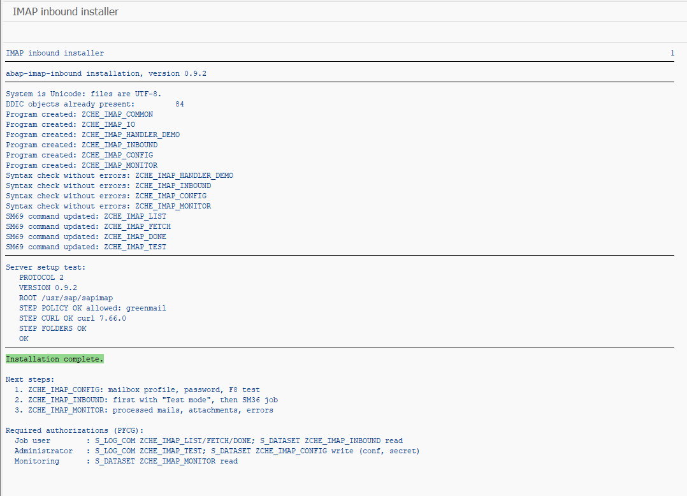

**Sonucu okuyun:** dört ana programın sözdizimi ve sunucu kontrolü başarılı; en sonda `Installation complete.` yazıyor. A4H/001'deki bu çalıştırma, sürüm etiketi 0.9.3'e yükseltilmeden önceki `9447cbd` düzeltmesine ait; ekranda hâlâ 0.9.2 yazıyor. [Görselin kapsamı](../screenshots/README.md).

Installer, oluşturduğu nesneleri `$TMP`'ye koyar; installer'ı kendi paketinize kaydetmek bunu değiştirmez. Kalıcı kullanımda nesneleri müşteri paketinize atayıp transport edin. [Paket ve transport](TECHNICAL-REFERENCE.md#2b-canlıya-çıkmadan-önce-paket-ve-transport).

### 3.3. Yetkileri kontrol edin

Programlar standart SAP yetkilerini kullanır: `ZCHI` tablo grubu için `S_TABU_DIS`, `ZCHE_IMAP_*` SM69 komutları için `S_LOG_COM` ve çalışma klasörü için `S_DATASET`. Geliştirici kullanıcısında genellikle bulunurlar; diğer kullanıcılar ve job kullanıcısı için [yetki tablosuna](../../SECURITY.md) bakın.

**İsteğe bağlı — profil bazında ayrım:** Farklı ekiplerin yalnızca kendi posta kutusunu görmesi gerekiyorsa SU21'de `ZCHE_IMAP` yetki nesnesini tanımlayın. Programlar bunu kendiliğinden denetler. [Kurulum adımları](../../SECURITY.md#optional-per-profile-authorization).

**Devam koşulu:** kendi kullanıcınızın ve job kullanıcısının standart yetkileri var.

### 3.4. Posta profilini kaydedin

**Profil**, bağlantı ve işleme ayarlarının birlikte saklanan adıdır. **SE38 → `ZCHE_IMAP_CONFIG` → F8** ile ayar ekranını açın. Ekranın içindeki F8, **ayarları kaydeder ve bağlantıyı kontrol eder**.

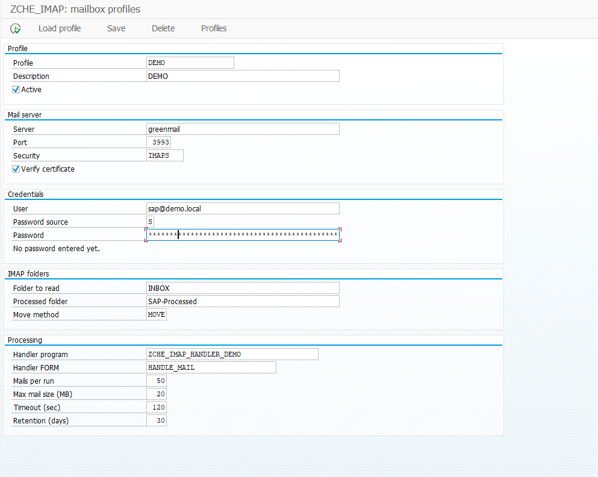

`greenmail`, `3993` portu ve `sap@demo.local` yerel deneme bilgileridir. Kendi posta hesabınızın gerçek bilgilerini kullanın. Görselde parola SAP'den girildiği için kaynak `S`; parola sunucuda yönetiliyorsa `O` seçilir.

| Alan | İlk kullanımda |
|---|---|
| Profile / Active | Seçtiğiniz ad; örneğin `DEMO`. Active işaretli. Bu adı sonraki adımlarda da kullanın. |
| Server, Port, Security | Posta yöneticisinin verdiği gerçek bilgiler. Sertifika doğrulaması açık. |
| User / Password source | Gerçek giriş adı; varsayılan `O`, parolayı sunucuda yöneticinin hazırlamasıdır. |
| Folder to read | `INBOX` veya seçtiğiniz gerçek kaynak klasör. |
| Processed folder | Aynı hesapta farklı, mevcut hedef klasör. `SAP-Processed` adı zorunlu değil. |
| Move method | `MOVE`. Posta sunucusu bu işlemi desteklemeli. |
| Handler program / FORM | `ZCHE_IMAP_HANDLER_DEMO` / `HANDLE_MAIL`. Hazır örnek iş programı. |

`O` kaynağı için sunucu yöneticisi, gerçek `SID_CLIENT_PROFILE` anahtarıyla parolayı [sunucuda hazırlar](TECHNICAL-REFERENCE.md#profil-alanları-ve-sunucuda-parola-yönetimi). `S` kaynağı SAP ekranından parola girişidir; izin ve koruma koşulları farklıdır. Kaydedilen parola ekranda geri gösterilmez.

[Diğer alanların açıklaması](SCREEN-GUIDE.md#profil). **Devam koşulu:** ayarlar kaydedilmiş ve doğru hesap için bağlantı kontrolü başarılı.

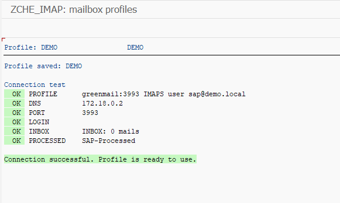

**Sonucu okuyun:** `LOGIN`, `INBOX` ve `PROCESSED` adımları başarılı. `INBOX: 0 mails`, kontrol anında gelen kutusunun boş olduğunu gösterir; bağlantı hatası değildir.

**Yerel deneme ayarı:** GreenMail'in kendinden imzalı test sertifikası için **Verify certificate** işareti kaldırıldı. Gerçek posta hesabında doğrulamayı açık tutun ve SAP sunucusunda güvenilir sertifika zincirini hazırlayın. Bu görüntü deneme bağlantısını gösterir; sertifika güveninin doğrulandığını göstermez.

Bağlantı sertifika hatasında durursa

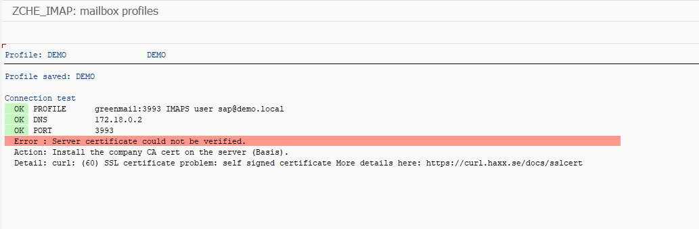

İlk deneme sunucuya ve porta ulaşmış, sertifika doğrulamasında durmuş. Posta sunucusunun sertifika zincirine güveni SAP sunucusunda yöneticinizle hazırlayın. Bu izole GreenMail denemesinde kullanıcı daha sonra **Verify certificate** işaretini kaldırdı; yukarıdaki başarılı bağlantı bu test istisnasıyla alındı.

## Yol A — Bağlantıyı ve ileti listesini kontrol edin

1. **SE38 → `ZCHE_IMAP_INBOUND` → F8** ile seçim ekranını açın.
2. Profil alanına **yalnız kendi deneme profilinizi** girin. Boş bırakmak bütün aktif profilleri kapsar.
3. **List only (no downloads/changes)** kutusunu **kendiniz işaretleyin**; başlangıçta işaretli olduğunu varsaymayın.
4. F8 ile çalıştırın. `UID`, posta sunucusunun ileti numarasıdır; belge numarası değildir.

**Başarı ölçütü:** uygun ileti numaraları veya boş kutu sonucu görülür. Bu yol **mail gövdesini/ekleri indirmez, handler'ı çalıştırmaz ve maili taşımaz**. [Seçim alanları](SCREEN-GUIDE.md#isleme).

## Yol B — İlk maili ve eki SAP'de açın

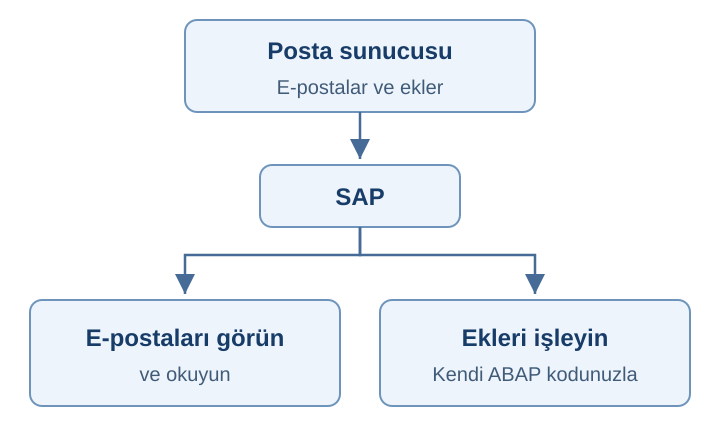

### B1. Ayrı bir deneme mailini işleyin

1. Deneme kutusuna küçük bir PDF veya metin eki içeren mail gönderin. Farklı kaynak klasör seçtiyseniz maili oraya koyun.
2. Aynı deneme profilinde hazır demo handler seçili olsun.
3. INBOUND ekranına dönün; **List only işaretini kaldırın** ve F8'e basın.

**Bu kez gerçek mail işlemesi başlar.** Mail ve ekler sunucuya alınır; hazır örnek ekleri okumayı dener. Başarılı mail hedef klasöre taşınır, okundu işaretlenebilir. Fatura veya sipariş oluşturulmaz.

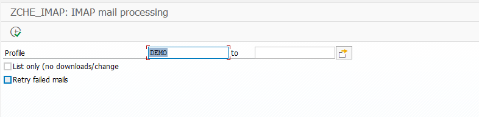

**Bu ekranda:** Yol B için `List only` işaretsiz. Yol A'da yalnız listelemek için çalıştırmadan önce işaretleyin. İlk gerçek denemeyi, profilin **Mails per run** alanında tek deneme mailiyle sınırlayın.

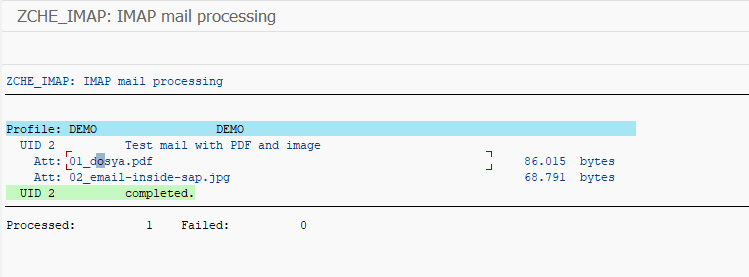

**Sonucu okuyun:** UID `2` tamamlanmış; PDF ve JPG listelenmiş; `Processed: 1`, `Failed: 0` yazıyor. Şimdi monitörde gövdeyi ve dosyaları açın; ardından mailin posta hesabındaki hedef klasörünü kontrol edin.

### B2. Monitörde kontrol edin

1. **SE38 → `ZCHE_IMAP_MONITOR` → F8** ile seçim ekranını açın.
2. Kendi profilinizi ve çalıştırmayı kapsayan tarih aralığını seçip F8'e basın.

   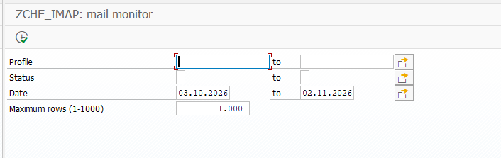

   **Bu ekranda:** bu örnek için `DEMO` yazın ve SAP işleme kaydındaki tarihi kapsayın. Görsel başlangıç filtrelerini gösteriyor; Profile henüz boş.

3. Sonuç listesini okuyun. Örnekte geçmişten gelen iki mail de **Done**; hata sayısı sıfır. Önceki tek mail çalıştırmasının kaydı UID `2`.

   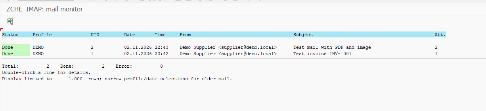

4. UID `2` satırına çift tıklayın; mail başlığını, gövdesini ve ek bağlantılarını inceleyin.

   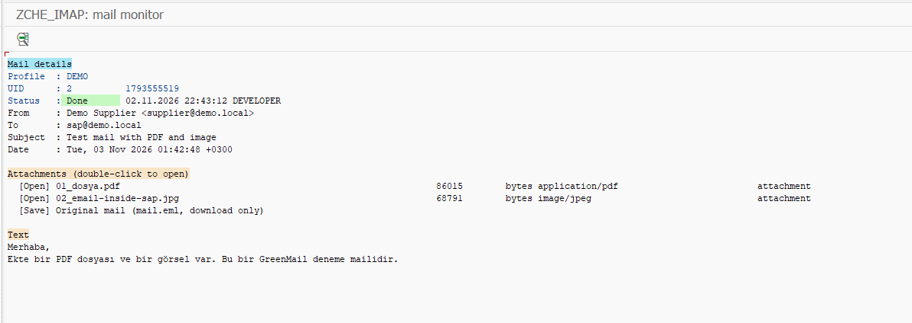

5. Ekin **Open** satırına çift tıklayın. Örnekte JPG, bilgisayarın görsel görüntüleyicisinde açılmış. PDF, metin ve desteklenen görseller uygun görüntüleyicide açılabilir; diğer türler yalnız indirilir. **Original mail**, EML dosyasını otomatik açmadan indirir.

   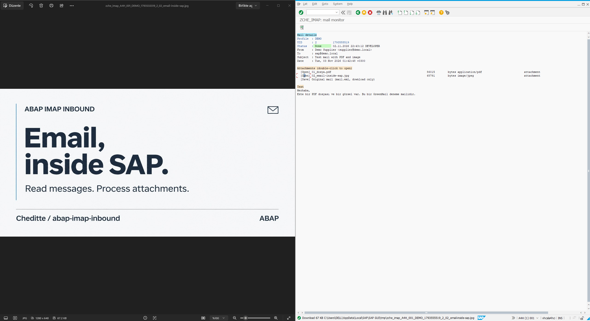

6. Posta hesabında mailin seçtiğiniz hedef klasöre geçtiğini kontrol edin. Paylaşılan görüntüler hedef klasör kontrolünü ve PDF'nin açılmasını henüz göstermiyor.

| Durum | Anlamı ve sonraki adım |
|---|---|
| `S` — Done | İşleme ve taşıma tamamlandı; eki ve hedef klasörü kontrol edin. |
| `E` — Error | Açıklamayı okuyup nedeni giderin. Normal çalıştırma hatalı maili tekrar tekrar işlemez. |
| `H` — To move | İş adımı kaydedildi, taşıma bekliyor. Normal çalıştırma yalnız taşımayı kurtarmayı dener. |
| `R` — Retry | Yetkili kullanıcı yeniden işleme istedi; sonraki normal çalıştırma yeniden deneyebilir. |

**Başarı ölçütü:** `S` kaydı, açılabilen ek ve hedef klasördeki mail birlikte doğrulanmış. Mail kutusu veya dosyaları silerek yeniden denemeyi zorlamayın. [Hata ve yeniden deneme](SCREEN-GUIDE.md#hatalar).

### B3. Kendi ABAP işleminizi ekleyin

Hazır akıştan sonra [geliştirici rehberindeki](TECHNICAL-GUIDE.md) handler'ı ayrı müşteri programına kopyalayın. İzinli ad önekini ve işlem sözleşmesini koruyun; mailin aynı iş belgesini ikinci kez oluşturmaması için kendi iş anahtarınızla tekrar kontrolü ekleyin. İşlem sonunda commit'i ana program yapar.

## Yol C — Belirli aralıklarla otomatik çalıştırın

**Akış:** seçimler → varyant → SM36 → SM37 log/spool. Varyant ayarları saklar; job bu ayarlarla programı çalıştırır.

### C1. Önce yalnız listeleyen bir varyant hazırlayın

INBOUND seçim ekranında kendi profilinizi girin, **List only işaretli** ve retry işaretsiz olsun. Varyant olarak örneğin `IMAP_LIST_DEMO` adıyla kaydedin; bu örnek adı kendi adınızla değiştirebilirsiniz. Varyantı tekrar çağırıp seçimleri kontrol edin.

### C2. SM36'da işi tanımlayın

1. **SM36** açın; kullanılmayan bir job adı girin. Görseldeki `ZCHE_IMAP_LIST_DEMO` yalnız örnektir.

   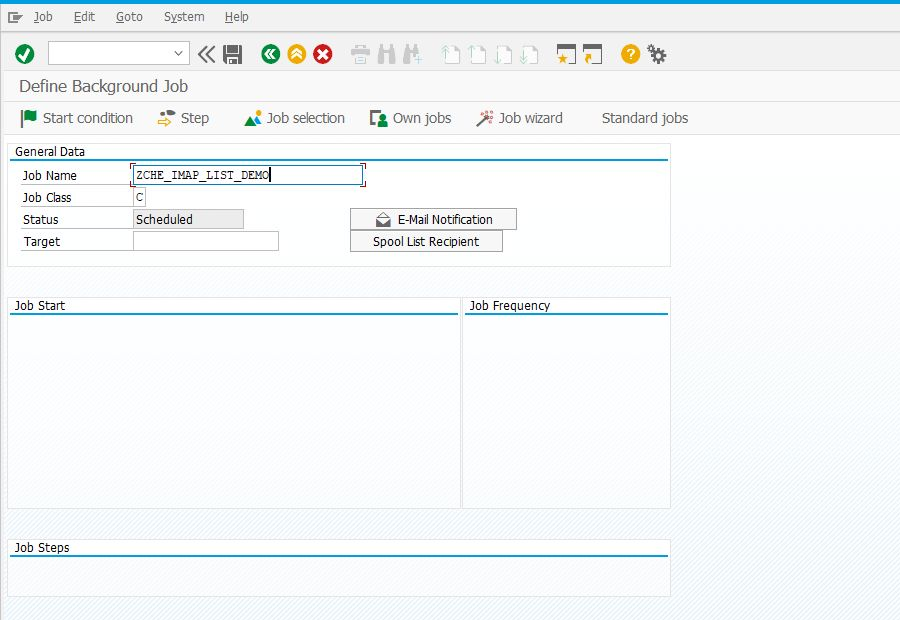

   **Bu ekranda:** **Job Name** işin adı, **Target** çalışacağı sunucu, **Step** program/varyant, **Start condition** başlangıç zamanıdır. Görsel kaydedilmemiş bir tanımı gösterir; kalan alanları aşağıdaki adımlarla tamamlayın.

2. Normal iş için **Job Class C** kullanın; kurumunuzun kuralı varsa onu izleyin.
3. **Target / Hedef** alanında kurulum yapılan uygulama sunucusunu seçin. Çok sunuculu sistemde boş hedefi rastgele sunucu seçimine bırakmayın.
4. **Step / Adım → ABAP program:** `ZCHE_IMAP_INBOUND` ve kaydettiğiniz listeleme varyantını girin. Doğru çalışma kullanıcısını kontrol edip adımı kaydedin.

### C3. Başlangıcı belirleyin ve sonucu okuyun

1. İlk kontrol için **Start condition → Immediate** seçin; **Periodic Job işaretsiz** olsun. Başlangıcı ve ana işi kaydedin.
2. **SM37**'de kendi iş adı, kullanıcı ve çalışma zamanıyla arayın; gerekirse durum filtrelerini genişletip yenileyin.
3. **Job log** ve **Spool** içindeki sonucu okuyun. **Finished, mail taşındığını göstermez:** listeleme işi içerik indirmez. Hata sayısı ve açıklamalar kontrol edilmeli.

Bu kontrolü gerçek job kullanıcısı ve seçilen sunucuda tamamladıktan sonra, B yolundaki normal işleme için **ayrı bir varyant ve job** hazırlayın. Yalnız o varyantta List only işaretini kaldırın. Çalışma aralığını operasyonla belirleyin; SM36'daki **Date/Time + Periodic Job + Period values** ile planlayın. SAP/job saat dilimini kontrol edin. İlk çalışmaları monitör, log/spool ve posta kutusuyla birlikte izleyin.

## Mevcut kurulumunuz varsa

İlk kurulum adımlarını doğrudan tekrar etmeyin. İşleri durdurup [güncelleme prosedürünü](TECHNICAL-REFERENCE.md#8-mevcut-kurulumu-güncelleyin) izleyin.

`0.9.x → 0.9.3` için SAP'deki installer kaynağını güncel dosyayla değiştirip etkinleştirin; sunucudaki iki betiği aynı sürüme güncelleyin. Yedekleme ve inceleme sonrasında **Programs + Overwrite existing programs (update) + Server check** seçin; gereken SM69/DDIC adımlarını mevcut kurulumunuza göre değerlendirin. Overwrite yerel kaynak değişikliklerini değiştirebilir. Sunucu kontrolü ve profil kontrolü başarılı olmadan işleri yeniden açmayın.

Eski `ZIMAP_` ve yeni `ZCHE_IMAP_` işleri aynı kutuyu birlikte işlememeli; eski geçmişin otomatik taşındığını varsaymayın.

## Takıldığınızda

[Alan rehberi](SCREEN-GUIDE.md) → ekranın anlamı ve doldurma kararı. [Teknik başvuru](TECHNICAL-REFERENCE.md) → bağlantı, sunucu, paket/transport. [SECURITY](../../SECURITY.md) → yetki ve parola dosyaları. Destek isterken adımı ve hata metnini paylaşın; parola veya gerçek mail içeriğini paylaşmayın.
